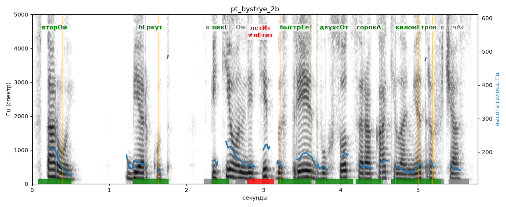

# pt_bystrye_2b

Голос: **Альбина, бот (без ударений в односложных)** · длительность 5.8 с
Естественность (UTMOS): **3.71 из 5** (живой диктор ≈ 4–4.5)
Эталон: Второй: беркут. В пике он летит быстрее двухсот сорока километров в час.
Распознано: Второй. Беркут. В пике он летит быстрее 240 километров в час.
Расхождения в словах: «двухсот сорока» → «240»

## Ударения
(где нужно: ruaccent)

| слово | нужно | у голоса | |
|---|---|---|---|
| второй | вторОй | вторОй | ✓ |
| беркут | бЕркут | бЕркут | ✓ |
| пике | пикЕ | пикЕ | ✓ |
| летит | летИт | лЕтит | ✗ ОШИБКА |
| быстрее | быстрЕе | быстрЕе | ✓ |
| двухсот | двухсОт | двухсОт | ✓ |
| сорока | сорокА | сорокА | ✓ |
| километров | киломЕтров | киломЕтров | ✓ |

## Интонация
- ✗ «второй беркут.» — конец фразы не понижается — звучит незаконченно / как перечисление
- ✓ «в пике он летит быстрее двухсот сорока километров в час.» — конец фразы понижается — звучит законченно
- Диапазон голоса 7.4 полутонов (живо), средняя высота 164 Гц

## Паузы и темп
- паузы на своих местах
- Темп 5.6 слога/с (нормально)

_Синяя линия — высота голоса. Над словами заглавная буква — где ударение должно быть; красным — голос поставил не туда (уверенно), оранжевым — возможно._
