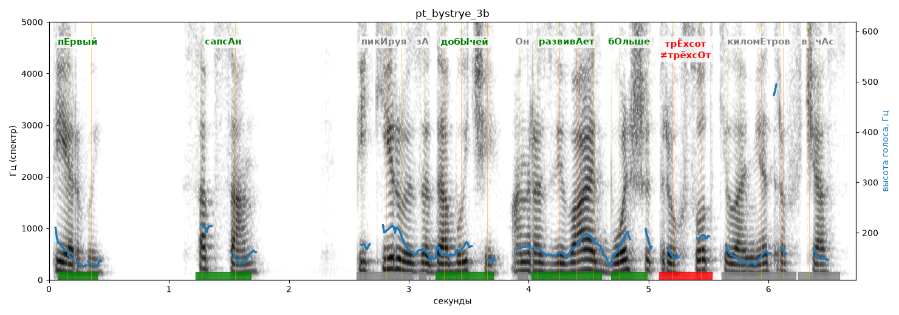

# pt_bystrye_3b

Голос: **Альбина, бот (без ударений в односложных)** · длительность 6.7 с
Естественность (UTMOS): **3.88 из 5** (живой диктор ≈ 4–4.5)
Эталон: Первый: сапсан. Пикируя за добычей, он развивает больше трёхсот километров в час.
Распознано: Первый. Сапсан. Пекируя за добычей, он развивает больше 300 километров в час.
Расхождения в словах: «пикируя» → «пекируя»; «трехсот» → «300»

## Ударения
(где нужно: ruaccent)

| слово | нужно | у голоса | |
|---|---|---|---|
| первый | пЕрвый | пЕрвый | ✓ |
| сапсан | сапсАн | сапсАн | ✓ |
| пикируя | пикИруя | — | ? |
| добычей | добЫчей | добЫчей | ✓ |
| развивает | развивАет | развивАет | ✓ |
| больше | бОльше | бОльше | ✓ |
| трёхсот | трЁхсот | трёхсОт | ✗ ОШИБКА |
| километров | киломЕтров | километрОв | ? не разобрать |

## Интонация
- ✓ «первый сапсан.» — конец фразы понижается — звучит законченно
- ✓ «пикируя за добычей он развивает больше трёхсот километров в час.» — конец фразы понижается — звучит законченно
- Диапазон голоса 7.1 полутонов (живо), средняя высота 163 Гц

## Паузы и темп
- паузы на своих местах
- Темп 5.6 слога/с (нормально)

_Синяя линия — высота голоса. Над словами заглавная буква — где ударение должно быть; красным — голос поставил не туда (уверенно), оранжевым — возможно._
