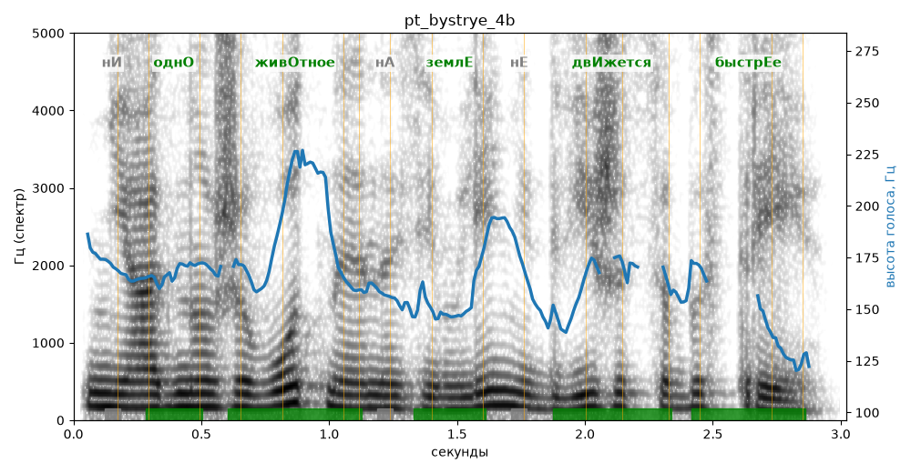

# pt_bystrye_4b

Голос: **Альбина, бот (без ударений в односложных)** · длительность 3.0 с
Естественность (UTMOS): **3.59 из 5** (живой диктор ≈ 4–4.5)
Эталон: Ни одно животное на Земле не движется быстрее.
Распознано: Ни одно животное на земле не движется быстрее.
Слова: все совпали

## Ударения
(где нужно: ruaccent)

| слово | нужно | у голоса | |
|---|---|---|---|
| одно | однО | однО | ✓ |
| животное | живОтное | живОтное | ✓ |
| земле | землЕ | землЕ | ✓ |
| движется | двИжется | двИжется | ✓ |
| быстрее | быстрЕе | быстрЕе | ✓ |

## Интонация
- ✓ «ни одно животное на земле не движется быстрее.» — конец фразы понижается — звучит законченно
- Диапазон голоса 8.4 полутонов (живо), средняя высота 165 Гц

## Паузы и темп
- паузы на своих местах
- Темп 6.2 слога/с (нормально)

_Синяя линия — высота голоса. Над словами заглавная буква — где ударение должно быть; красным — голос поставил не туда (уверенно), оранжевым — возможно._
