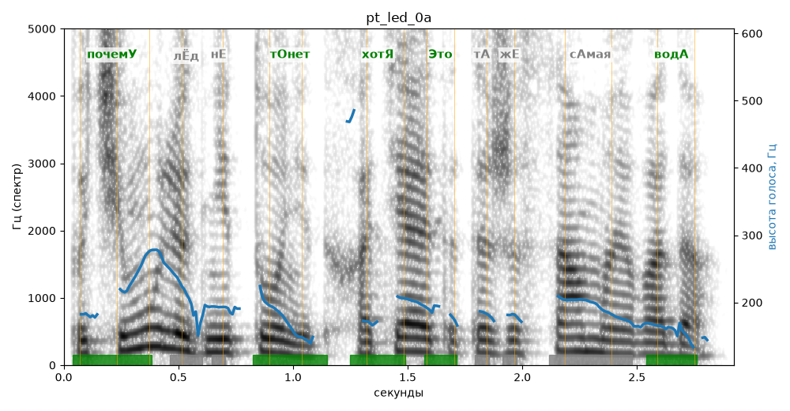

# pt_led_0a

Голос: **Альбина, бот (ударения во всех словах)** · длительность 2.9 с
Естественность (UTMOS): **3.95 из 5** (живой диктор ≈ 4–4.5)
Эталон: Почему лёд не тонет, хотя это та же самая вода?
Распознано: Почему лёг не тонет, хотя это же самая вода?
Расхождения в словах: «лед» → «лег»; «та» → «»

## Ударения
(где нужно: ruaccent)

| слово | нужно | у голоса | |
|---|---|---|---|
| почему | почемУ | почемУ | ✓ |
| тонет | тОнет | тОнет | ✓ |
| хотя | хотЯ | хотЯ | ✓ |
| это | Это | Это | ✓ |
| самая | сАмая | — | ? |
| вода | водА | водА | ✓ |

## Интонация
- ✓ «почему лёд не тонет хотя это та же самая вода?» — конец фразы понижается — звучит законченно
- Диапазон голоса 10.4 полутонов (живо), средняя высота 187 Гц

## Паузы и темп
- паузы на своих местах
- Темп 6.2 слога/с (нормально)

_Синяя линия — высота голоса. Над словами заглавная буква — где ударение должно быть; красным — голос поставил не туда (уверенно), оранжевым — возможно._
