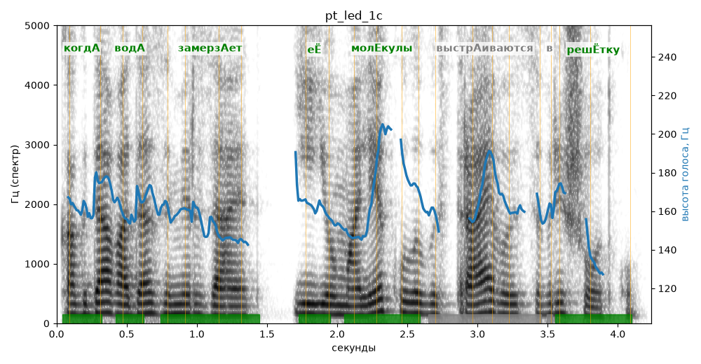

# pt_led_1c

Голос: **Альбина, бот (режим bot)** · длительность 4.2 с
Естественность (UTMOS): **3.08 из 5** (живой диктор ≈ 4–4.5)
Эталон: Когда вода замерзает, её молекулы выстраиваются в решётку.
Распознано: Когда вода замерзает, её молекулы выстраиваются в решётку.
Слова: все совпали

## Ударения
(где нужно: ruaccent)

| слово | нужно | у голоса | |
|---|---|---|---|
| когда | когдА | когдА | ✓ |
| вода | водА | водА | ✓ |
| замерзает | замерзАет | замерзАет | ✓ |
| её | еЁ | еЁ | ✓ |
| молекулы | молЕкулы | молЕкулы | ✓ |
| выстраиваются | выстрАиваются | — | ? |
| решётку | решЁтку | решЁтку | ✓ |

## Интонация
- ✓ «когда вода замерзает её молекулы выстраиваются в решётку.» — конец фразы понижается — звучит законченно
- Диапазон голоса 4.7 полутонов (нормально), средняя высота 161 Гц

## Паузы и темп
- паузы на своих местах
- Темп 6.1 слога/с (нормально)

_Синяя линия — высота голоса. Над словами заглавная буква — где ударение должно быть; красным — голос поставил не туда (уверенно), оранжевым — возможно._
