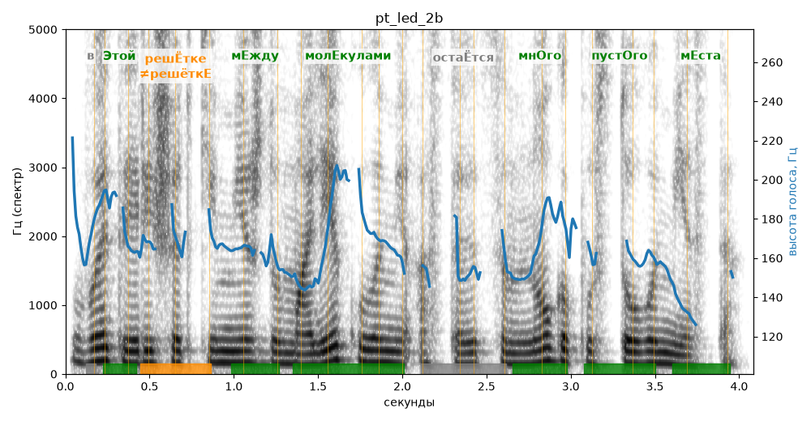

# pt_led_2b

Голос: **Альбина, бот (без ударений в односложных)** · длительность 4.1 с
Естественность (UTMOS): **3.66 из 5** (живой диктор ≈ 4–4.5)
Эталон: В этой решётке между молекулами остаётся много пустого места.
Распознано: В этой решетке между молекулами остается много пустого места.
Слова: все совпали

## Ударения
(где нужно: ruaccent)

| слово | нужно | у голоса | |
|---|---|---|---|
| этой | Этой | Этой | ✓ |
| решётке | решЁтке | решёткЕ | ✗? возможно — послушать |
| между | мЕжду | мЕжду | ✓ |
| молекулами | молЕкулами | молЕкулами | ✓ |
| остаётся | остаЁтся | остаётсЯ | ? не разобрать |
| много | мнОго | мнОго | ✓ |
| пустого | пустОго | пустОго | ✓ |
| места | мЕста | мЕста | ✓ |

## Интонация
- ✓ «в этой решётке между молекулами остаётся много пустого места.» — конец фразы понижается — звучит законченно
- Диапазон голоса 5.2 полутонов (нормально), средняя высота 164 Гц

## Паузы и темп
- паузы на своих местах
- Темп 6.3 слога/с (нормально)

_Синяя линия — высота голоса. Над словами заглавная буква — где ударение должно быть; красным — голос поставил не туда (уверенно), оранжевым — возможно._
