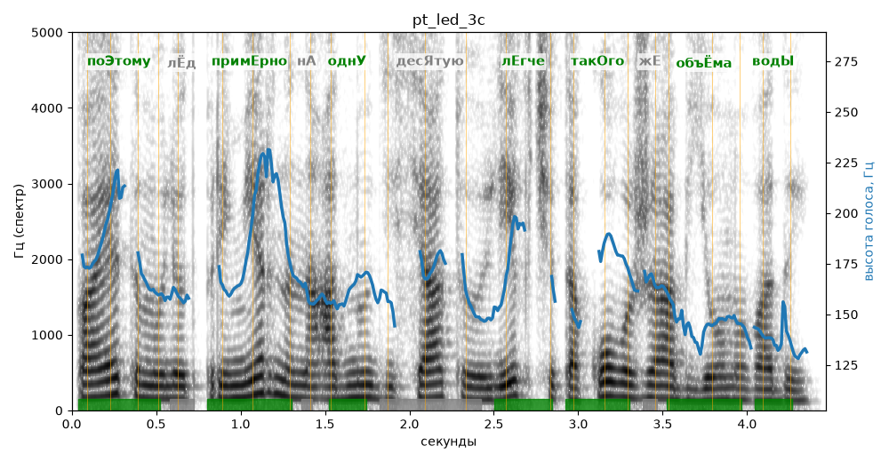

# pt_led_3c

Голос: **Альбина, бот (режим bot)** · длительность 4.5 с
Естественность (UTMOS): **3.2 из 5** (живой диктор ≈ 4–4.5)
Эталон: Поэтому лёд примерно на одну десятую легче такого же объёма воды.
Распознано: Поэтому лед примерно на 1 десятую легче такого же объема воды.
Расхождения в словах: «одну» → «1»

## Ударения
(где нужно: ruaccent)

| слово | нужно | у голоса | |
|---|---|---|---|
| поэтому | поЭтому | поЭтому | ✓ |
| примерно | примЕрно | примЕрно | ✓ |
| одну | однУ | однУ | ✓ |
| десятую | десЯтую | — | ? |
| легче | лЕгче | лЕгче | ✓ |
| такого | такОго | такОго | ✓ |
| объёма | объЁма | объЁма | ✓ |
| воды | водЫ | водЫ | ✓ |

## Интонация
- ✓ «поэтому лёд примерно на одну десятую легче такого же объёма воды.» — конец фразы понижается — звучит законченно
- Диапазон голоса 7.9 полутонов (живо), средняя высота 162 Гц

## Паузы и темп
- паузы на своих местах
- Темп 5.9 слога/с (нормально)

_Синяя линия — высота голоса. Над словами заглавная буква — где ударение должно быть; красным — голос поставил не туда (уверенно), оранжевым — возможно._
