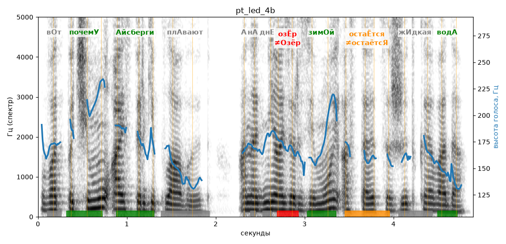

# pt_led_4b

Голос: **Альбина, бот (без ударений в односложных)** · длительность 4.9 с
Естественность (UTMOS): **3.41 из 5** (живой диктор ≈ 4–4.5)
Эталон: Вот почему айсберги плавают, а на дне озёр зимой остаётся жидкая вода.
Распознано: Вот почему айсберги плавают, а на дне озер зимой остается жидкая вода.
Слова: все совпали

## Ударения
(где нужно: ruaccent)

| слово | нужно | у голоса | |
|---|---|---|---|
| почему | почемУ | почемУ | ✓ |
| айсберги | Айсберги | Айсберги | ✓ |
| плавают | плАвают | — | ? |
| озёр | озЁр | Озёр | ✗ ОШИБКА |
| зимой | зимОй | зимОй | ✓ |
| остаётся | остаЁтся | остаётсЯ | ✗? возможно — послушать |
| жидкая | жИдкая | — | ? |
| вода | водА | водА | ✓ |

## Интонация
- ✓ «вот почему айсберги плавают а на дне озёр зимой остаётся жидкая вода.» — конец фразы понижается — звучит законченно
- Диапазон голоса 7.9 полутонов (живо), средняя высота 166 Гц

## Паузы и темп
- паузы на своих местах
- Темп 5.9 слога/с (нормально)

_Синяя линия — высота голоса. Над словами заглавная буква — где ударение должно быть; красным — голос поставил не туда (уверенно), оранжевым — возможно._
