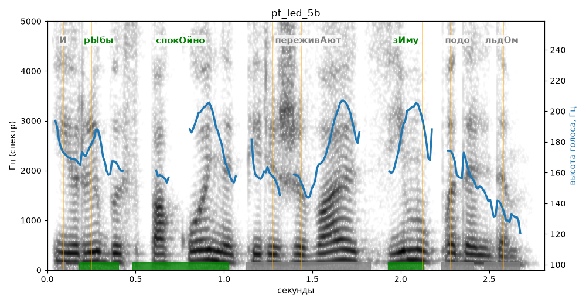

# pt_led_5b

Голос: **Альбина, бот (без ударений в односложных)** · длительность 2.8 с
Естественность (UTMOS): **3.61 из 5** (живой диктор ≈ 4–4.5)
Эталон: И рыбы спокойно переживают зиму подо льдом.
Распознано: и рыбы спокойно переживают зиму под альдом.
Расхождения в словах: «подо льдом» → «под альдом»

## Ударения
(где нужно: ruaccent)

| слово | нужно | у голоса | |
|---|---|---|---|
| рыбы | рЫбы | рЫбы | ✓ |
| спокойно | спокОйно | спокОйно | ✓ |
| переживают | переживАют | — | ? |
| зиму | зИму | зИму | ✓ |
| подо | подо | подО | нет эталона |

## Интонация
- ✓ «и рыбы спокойно переживают зиму подо льдом.» — конец фразы понижается — звучит законченно
- Диапазон голоса 7.4 полутонов (живо), средняя высота 167 Гц

## Паузы и темп
- паузы на своих местах
- Темп 5.8 слога/с (нормально)

_Синяя линия — высота голоса. Над словами заглавная буква — где ударение должно быть; красным — голос поставил не туда (уверенно), оранжевым — возможно._
