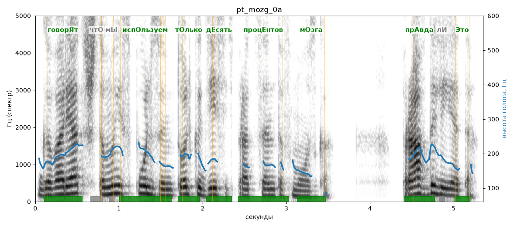

# pt_mozg_0a

Голос: **Альбина, бот (ударения во всех словах)** · длительность 5.4 с
Естественность (UTMOS): **3.67 из 5** (живой диктор ≈ 4–4.5)
Эталон: Говорят, что мы используем только десять процентов мозга. Правда ли это?
Распознано: говорят, что мы используем только 10% мозга. Правда ли это?
Расхождения в словах: «десять процентов» → «10»

## Ударения
(где нужно: ruaccent)

| слово | нужно | у голоса | |
|---|---|---|---|
| говорят | говорЯт | говорЯт | ✓ |
| используем | испОльзуем | испОльзуем | ✓ |
| только | тОлько | тОлько | ✓ |
| десять | дЕсять | дЕсять | ✓ |
| процентов | процЕнтов | процЕнтов | ✓ |
| мозга | мОзга | мОзга | ✓ |
| правда | прАвда | прАвда | ✓ |
| это | Это | Это | ✓ |

## Интонация
- ✓ «говорят что мы используем только десять процентов мозга.» — конец фразы понижается — звучит законченно
- ✗ «правда ли это?» — нет вопросительного подъёма (самое высокое место — «правда», в начале) — звучит как утверждение
- Диапазон голоса 7.4 полутонов (живо), средняя высота 183 Гц

## Паузы и темп
- паузы на своих местах
- Темп 5.5 слога/с (нормально)

_Синяя линия — высота голоса. Над словами заглавная буква — где ударение должно быть; красным — голос поставил не туда (уверенно), оранжевым — возможно._
