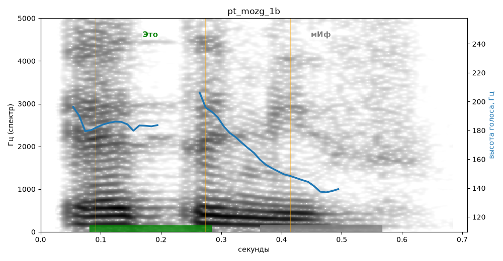

# pt_mozg_1b

Голос: **Альбина, бот (без ударений в односложных)** · длительность 0.7 с
Естественность (UTMOS): **3.56 из 5** (живой диктор ≈ 4–4.5)
Эталон: Это миф.
Распознано: Это МИФ.
Слова: все совпали

## Ударения
(где нужно: ruaccent)

| слово | нужно | у голоса | |
|---|---|---|---|
| это | Это | Это | ✓ |

## Интонация
- ✓ «это миф.» — конец фразы понижается — звучит законченно
- Диапазон голоса 6.1 полутонов (нормально), средняя высота 179 Гц

## Паузы и темп
- паузы на своих местах
- Темп 6.2 слога/с (нормально)

_Синяя линия — высота голоса. Над словами заглавная буква — где ударение должно быть; красным — голос поставил не туда (уверенно), оранжевым — возможно._
