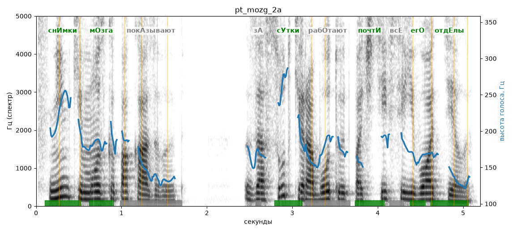

# pt_mozg_2a

Голос: **Альбина, бот (ударения во всех словах)** · длительность 5.2 с
Естественность (UTMOS): **4.16 из 5** (живой диктор ≈ 4–4.5)
Эталон: Снимки мозга показывают: за сутки работают почти все его отделы.
Распознано: Снимки мозга показывают. За сутки работают почти все его отделы.
Слова: все совпали

## Ударения
(где нужно: ruaccent)

| слово | нужно | у голоса | |
|---|---|---|---|
| снимки | снИмки | снИмки | ✓ |
| мозга | мОзга | мОзга | ✓ |
| показывают | покАзывают | — | ? |
| сутки | сУтки | сУтки | ✓ |
| работают | рабОтают | — | ? |
| почти | почтИ | почтИ | ✓ |
| его | егО | егО | ✓ |
| отделы | отдЕлы | отдЕлы | ✓ |

## Интонация
- ✓ «снимки мозга показывают за сутки работают почти все его отделы.» — конец фразы понижается — звучит законченно
- Диапазон голоса 11.1 полутонов (живо), средняя высота 171 Гц

## Паузы и темп
- паузы на своих местах
- Темп 5.6 слога/с (нормально)

_Синяя линия — высота голоса. Над словами заглавная буква — где ударение должно быть; красным — голос поставил не туда (уверенно), оранжевым — возможно._
