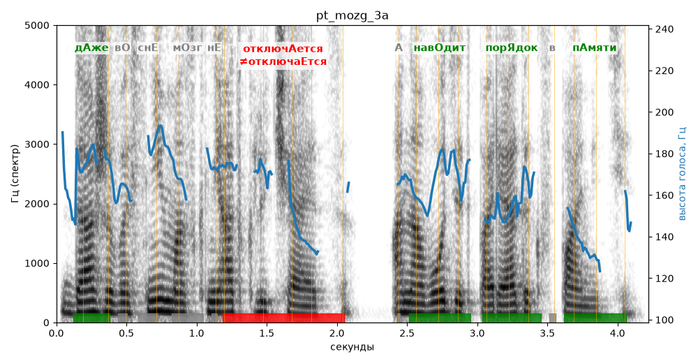

# pt_mozg_3a

Голос: **Альбина, бот (ударения во всех словах)** · длительность 4.2 с
Естественность (UTMOS): **3.8 из 5** (живой диктор ≈ 4–4.5)
Эталон: Даже во сне мозг не отключается, а наводит порядок в памяти.
Распознано: Даже во сне мозг не отключается, она водит порядок в памяти.
Расхождения в словах: «а наводит» → «она водит»

## Ударения
(где нужно: ruaccent)

| слово | нужно | у голоса | |
|---|---|---|---|
| даже | дАже | дАже | ✓ |
| отключается | отключАется | отключаЕтся | ✗ ОШИБКА |
| наводит | навОдит | навОдит | ✓ |
| порядок | порЯдок | порЯдок | ✓ |
| памяти | пАмяти | пАмяти | ✓ |

## Интонация
- ✓ «даже во сне мозг не отключается а наводит порядок в памяти.» — конец фразы понижается — звучит законченно
- Диапазон голоса 5.6 полутонов (нормально), средняя высота 165 Гц

## Паузы и темп
- паузы на своих местах
- Темп 6.2 слога/с (нормально)

_Синяя линия — высота голоса. Над словами заглавная буква — где ударение должно быть; красным — голос поставил не туда (уверенно), оранжевым — возможно._
