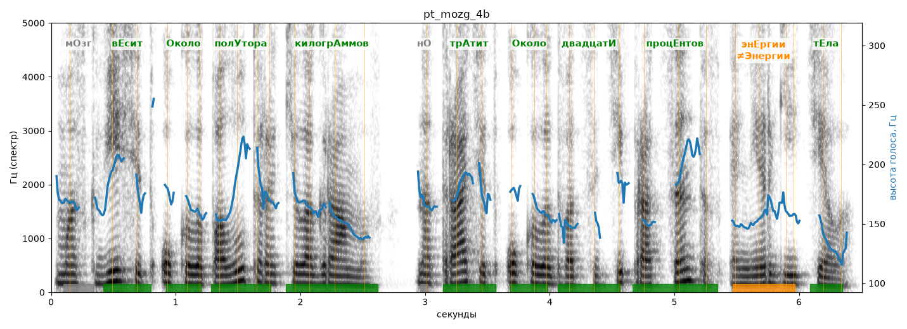

# pt_mozg_4b

Голос: **Альбина, бот (без ударений в односложных)** · длительность 6.5 с
Естественность (UTMOS): **3.71 из 5** (живой диктор ≈ 4–4.5)
Эталон: Мозг весит около полутора килограммов, но тратит около двадцати процентов энергии тела.
Распознано: Моск весит около полутора килограммов, на тратит около 20% энергии тела.
Расхождения в словах: «мозг» → «моск»; «но» → «на»; «двадцати процентов» → «20»

## Ударения
(где нужно: ruaccent)

| слово | нужно | у голоса | |
|---|---|---|---|
| весит | вЕсит | вЕсит | ✓ |
| около | Около | Около | ✓ |
| полутора | полУтора | полУтора | ✓ |
| килограммов | килогрАммов | килогрАммов | ✓ |
| тратит | трАтит | трАтит | ✓ |
| около | Около | Около | ✓ |
| двадцати | двадцатИ | двадцатИ | ✓ |
| процентов | процЕнтов | процЕнтов | ✓ |
| энергии | энЕргии | Энергии | ✗? возможно — послушать |
| тела | тЕла | тЕла | ✓ |

## Интонация
- ✓ «мозг весит около полутора килограммов но тратит около двадцати процентов энергии тела.» — конец фразы понижается — звучит законченно
- Диапазон голоса 7.2 полутонов (живо), средняя высота 163 Гц

## Паузы и темп
- паузы на своих местах
- Темп 5.4 слога/с (нормально)

_Синяя линия — высота голоса. Над словами заглавная буква — где ударение должно быть; красным — голос поставил не туда (уверенно), оранжевым — возможно._
