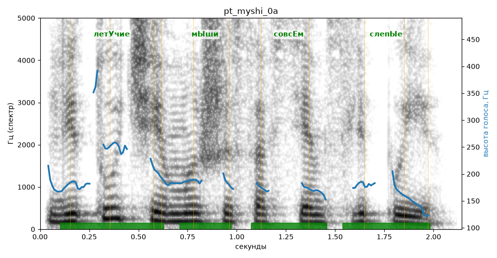

# pt_myshi_0a

Голос: **Альбина, бот (ударения во всех словах)** · длительность 2.1 с
Естественность (UTMOS): **3.91 из 5** (живой диктор ≈ 4–4.5)
Эталон: Летучие мыши совсем слепые?
Распознано: Летучие мыши совсем слепые.
Слова: все совпали

## Ударения
(где нужно: ruaccent)

| слово | нужно | у голоса | |
|---|---|---|---|
| летучие | летУчие | летУчие | ✓ |
| мыши | мЫши | мЫши | ✓ |
| совсем | совсЕм | совсЕм | ✓ |
| слепые | слепЫе | слепЫе | ✓ |

## Интонация
- ✗ «летучие мыши совсем слепые?» — нет вопросительного подъёма (самое высокое место — «летучие», в начале) — звучит как утверждение
- Диапазон голоса 9.9 полутонов (живо), средняя высота 181 Гц

## Паузы и темп
- паузы на своих местах
- Темп 5.8 слога/с (нормально)

_Синяя линия — высота голоса. Над словами заглавная буква — где ударение должно быть; красным — голос поставил не туда (уверенно), оранжевым — возможно._
