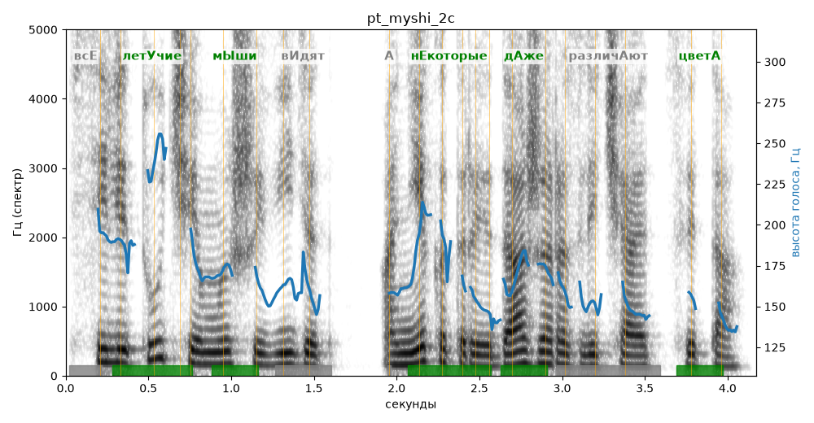

# pt_myshi_2c

Голос: **Альбина, бот (режим bot)** · длительность 4.2 с
Естественность (UTMOS): **3.88 из 5** (живой диктор ≈ 4–4.5)
Эталон: Все летучие мыши видят, а некоторые даже различают цвета.
Распознано: Всели тучи и мыши видят, а некоторые даже различают цвета.
Расхождения в словах: «все летучие» → «всели тучи и»

## Ударения
(где нужно: ruaccent)

| слово | нужно | у голоса | |
|---|---|---|---|
| летучие | летУчие | летУчие | ✓ |
| мыши | мЫши | мЫши | ✓ |
| видят | вИдят | видЯт | ? не разобрать |
| некоторые | нЕкоторые | нЕкоторые | ✓ |
| даже | дАже | дАже | ✓ |
| различают | различАют | — | ? |
| цвета | цветА | цветА | ✓ |

## Интонация
- ✓ «все летучие мыши видят а некоторые даже различают цвета.» — конец фразы понижается — звучит законченно
- Диапазон голоса 7.3 полутонов (живо), средняя высота 163 Гц

## Паузы и темп
- паузы на своих местах
- Темп 6.1 слога/с (нормально)

_Синяя линия — высота голоса. Над словами заглавная буква — где ударение должно быть; красным — голос поставил не туда (уверенно), оранжевым — возможно._
