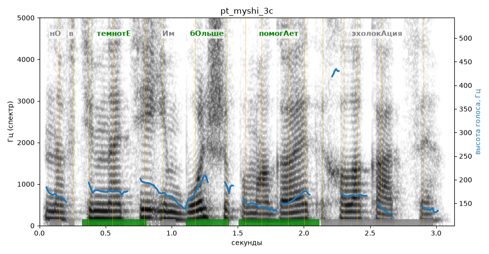

# pt_myshi_3c

Голос: **Альбина, бот (режим bot)** · длительность 3.1 с
Естественность (UTMOS): **3.83 из 5** (живой диктор ≈ 4–4.5)
Эталон: Но в темноте им больше помогает эхолокация.
Распознано: Но в темноте им больше помогает их аллокация.
Расхождения в словах: «эхолокация» → «их аллокация»

## Ударения
(где нужно: ruaccent)

| слово | нужно | у голоса | |
|---|---|---|---|
| темноте | темнотЕ | темнотЕ | ✓ |
| больше | бОльше | бОльше | ✓ |
| помогает | помогАет | помогАет | ✓ |
| эхолокация | эхолокАция | — | ? |

## Интонация
- ✓ «но в темноте им больше помогает эхолокация.» — конец фразы понижается — звучит законченно
- Диапазон голоса 6.9 полутонов (нормально), средняя высота 166 Гц

## Паузы и темп
- паузы на своих местах
- Темп 5.9 слога/с (нормально)

_Синяя линия — высота голоса. Над словами заглавная буква — где ударение должно быть; красным — голос поставил не туда (уверенно), оранжевым — возможно._
