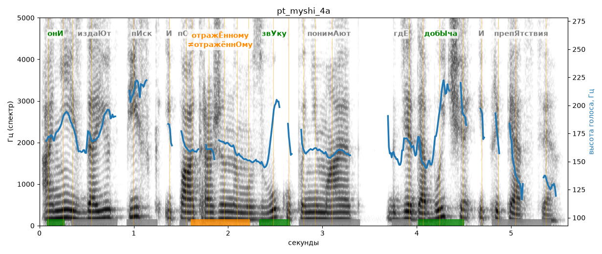

# pt_myshi_4a

Голос: **Альбина, бот (ударения во всех словах)** · длительность 5.6 с
Естественность (UTMOS): **3.53 из 5** (живой диктор ≈ 4–4.5)
Эталон: Они издают писк и по отражённому звуку понимают, где добыча и препятствия.
Распознано: Они издают писк и по отраженному звуку понимают, где добыча и препятствия.
Слова: все совпали

## Ударения
(где нужно: ruaccent)

| слово | нужно | у голоса | |
|---|---|---|---|
| они | онИ | онИ | ✓ |
| издают | издаЮт | — | ? |
| отражённому | отражЁнному | отражённОму | ✗? возможно — послушать |
| звуку | звУку | звУку | ✓ |
| понимают | понимАют | — | ? |
| добыча | добЫча | добЫча | ✓ |
| препятствия | препЯтствия | — | ? |

## Интонация
- ✓ «они издают писк и по отражённому звуку понимают где добыча и препятствия.» — конец фразы понижается — звучит законченно
- Диапазон голоса 7.9 полутонов (живо), средняя высота 162 Гц

## Паузы и темп
- паузы на своих местах
- Темп 5.2 слога/с (нормально)

_Синяя линия — высота голоса. Над словами заглавная буква — где ударение должно быть; красным — голос поставил не туда (уверенно), оранжевым — возможно._
