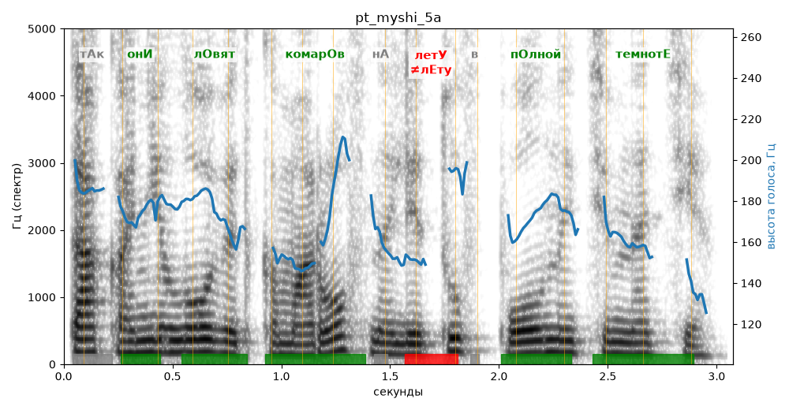

# pt_myshi_5a

Голос: **Альбина, бот (ударения во всех словах)** · длительность 3.1 с
Естественность (UTMOS): **2.61 из 5** (живой диктор ≈ 4–4.5)
Эталон: Так они ловят комаров на лету в полной темноте.
Распознано: Так они ловят комаров на литу в полной темноте.
Расхождения в словах: «лету» → «литу»

## Ударения
(где нужно: ruaccent)

| слово | нужно | у голоса | |
|---|---|---|---|
| они | онИ | онИ | ✓ |
| ловят | лОвят | лОвят | ✓ |
| комаров | комарОв | комарОв | ✓ |
| лету | летУ | лЕту | ✗ ОШИБКА |
| полной | пОлной | пОлной | ✓ |
| темноте | темнотЕ | темнотЕ | ✓ |

## Интонация
- ✓ «так они ловят комаров на лету в полной темноте.» — конец фразы понижается — звучит законченно
- Диапазон голоса 5.0 полутонов (нормально), средняя высота 170 Гц

## Паузы и темп
- паузы на своих местах
- Темп 6.0 слога/с (нормально)

_Синяя линия — высота голоса. Над словами заглавная буква — где ударение должно быть; красным — голос поставил не туда (уверенно), оранжевым — возможно._
