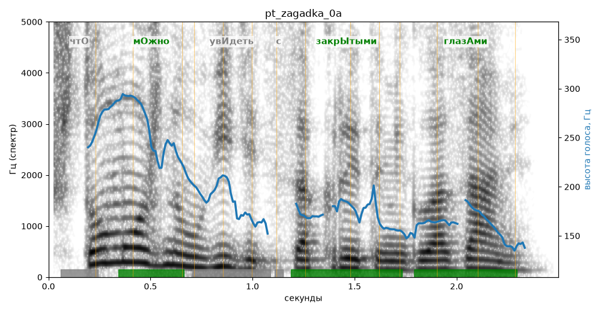

# pt_zagadka_0a

Голос: **Альбина, бот (ударения во всех словах)** · длительность 2.5 с
Естественность (UTMOS): **3.47 из 5** (живой диктор ≈ 4–4.5)
Эталон: Что можно увидеть с закрытыми глазами?
Распознано: Что можно увидеть с закрытыми глазами?
Слова: все совпали

## Ударения
(где нужно: ruaccent)

| слово | нужно | у голоса | |
|---|---|---|---|
| можно | мОжно | мОжно | ✓ |
| увидеть | увИдеть | Увидеть | ? не разобрать |
| закрытыми | закрЫтыми | закрЫтыми | ✓ |
| глазами | глазАми | глазАми | ✓ |

## Интонация
- ✗ «что можно увидеть с закрытыми глазами?» — конец фразы не понижается — звучит незаконченно / как перечисление
- Диапазон голоса 12.1 полутонов (живо), средняя высота 176 Гц

## Паузы и темп
- паузы на своих местах
- Темп 6.3 слога/с (нормально)

_Синяя линия — высота голоса. Над словами заглавная буква — где ударение должно быть; красным — голос поставил не туда (уверенно), оранжевым — возможно._
