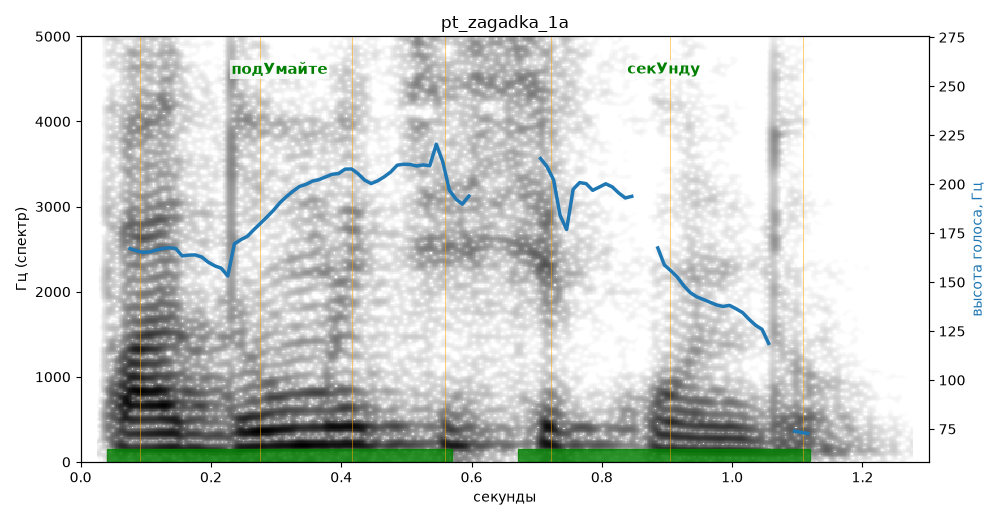

# pt_zagadka_1a

Голос: **Альбина, бот (ударения во всех словах)** · длительность 1.3 с
Естественность (UTMOS): **3.4 из 5** (живой диктор ≈ 4–4.5)
Эталон: Подумайте секунду.
Распознано: Подумайте секунду.
Слова: все совпали

## Ударения
(где нужно: ruaccent)

| слово | нужно | у голоса | |
|---|---|---|---|
| подумайте | подУмайте | подУмайте | ✓ |
| секунду | секУнду | секУнду | ✓ |

## Интонация
- ✓ «подумайте секунду.» — конец фразы понижается — звучит законченно
- Диапазон голоса 8.7 полутонов (живо), средняя высота 184 Гц

## Паузы и темп
- паузы на своих местах
- Темп 6.5 слога/с (нормально)

_Синяя линия — высота голоса. Над словами заглавная буква — где ударение должно быть; красным — голос поставил не туда (уверенно), оранжевым — возможно._
