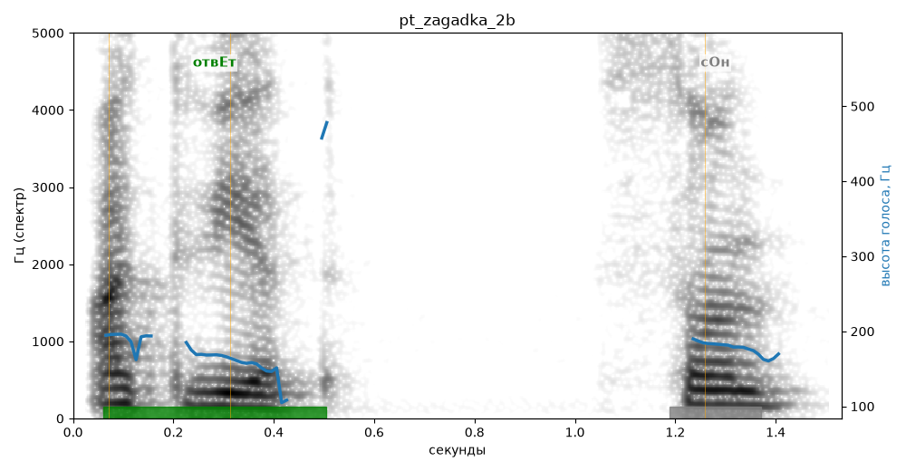

# pt_zagadka_2b

Голос: **Альбина, бот (без ударений в односложных)** · длительность 1.5 с
Естественность (UTMOS): **3.56 из 5** (живой диктор ≈ 4–4.5)
Эталон: Ответ: сон.
Распознано: Ответ. Сон.
Слова: все совпали

## Ударения
(где нужно: ruaccent)

| слово | нужно | у голоса | |
|---|---|---|---|
| ответ | отвЕт | отвЕт | ✓ |

## Интонация
- ✗ «ответ сон.» — конец фразы не понижается — звучит незаконченно / как перечисление
- Диапазон голоса 5.0 полутонов (нормально), средняя высота 174 Гц

## Паузы и темп
- паузы на своих местах
- Темп 4.8 слога/с (нормально)

_Синяя линия — высота голоса. Над словами заглавная буква — где ударение должно быть; красным — голос поставил не туда (уверенно), оранжевым — возможно._
