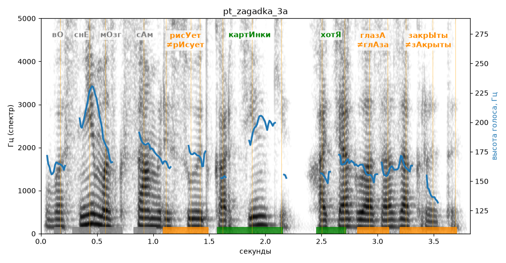

# pt_zagadka_3a

Голос: **Альбина, бот (ударения во всех словах)** · длительность 3.8 с
Естественность (UTMOS): **3.72 из 5** (живой диктор ≈ 4–4.5)
Эталон: Во сне мозг сам рисует картинки, хотя глаза закрыты.
Распознано: У вас не мозг сам рисует картинки, хотя глаза закрыты.
Расхождения в словах: «во сне» → «у вас не»

## Ударения
(где нужно: ruaccent)

| слово | нужно | у голоса | |
|---|---|---|---|
| рисует | рисУет | рИсует | ✗? возможно — послушать |
| картинки | картИнки | картИнки | ✓ |
| хотя | хотЯ | хотЯ | ✓ |
| глаза | глазА | глАза | ✗? возможно — послушать |
| закрыты | закрЫты | зАкрыты | ✗? возможно — послушать |

## Интонация
- ✓ «во сне мозг сам рисует картинки хотя глаза закрыты.» — конец фразы понижается — звучит законченно
- Диапазон голоса 6.1 полутонов (нормально), средняя высота 166 Гц

## Паузы и темп
- паузы на своих местах
- Темп 5.2 слога/с (нормально)

_Синяя линия — высота голоса. Над словами заглавная буква — где ударение должно быть; красным — голос поставил не туда (уверенно), оранжевым — возможно._
