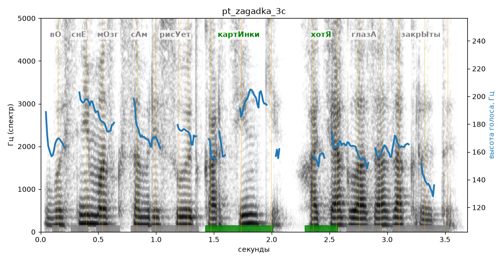

# pt_zagadka_3c

Голос: **Альбина, бот (режим bot)** · длительность 3.7 с
Естественность (UTMOS): **3.77 из 5** (живой диктор ≈ 4–4.5)
Эталон: Во сне мозг сам рисует картинки, хотя глаза закрыты.
Распознано: Восне маск сам рисует картинки, хотя глаза закрыты.
Расхождения в словах: «во сне мозг» → «восне маск»

## Ударения
(где нужно: ruaccent)

| слово | нужно | у голоса | |
|---|---|---|---|
| рисует | рисУет | рисуЕт | ? не разобрать |
| картинки | картИнки | картИнки | ✓ |
| хотя | хотЯ | хотЯ | ✓ |
| глаза | глазА | глАза | ? не разобрать |
| закрыты | закрЫты | зАкрыты | ? не разобрать |

## Интонация
- ✓ «во сне мозг сам рисует картинки хотя глаза закрыты.» — конец фразы понижается — звучит законченно
- Диапазон голоса 5.2 полутонов (нормально), средняя высота 167 Гц

## Паузы и темп
- паузы на своих местах
- Темп 5.4 слога/с (нормально)

_Синяя линия — высота голоса. Над словами заглавная буква — где ударение должно быть; красным — голос поставил не туда (уверенно), оранжевым — возможно._
