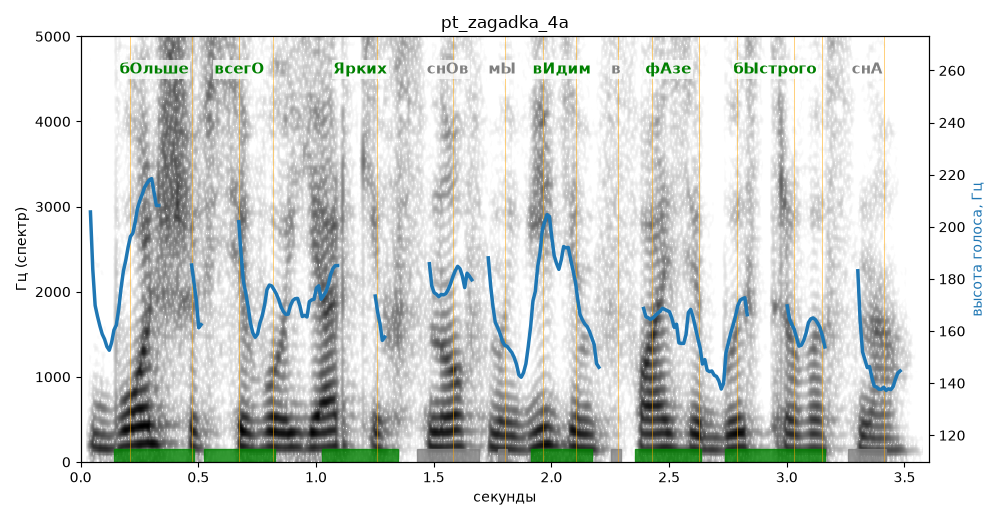

# pt_zagadka_4a

Голос: **Альбина, бот (ударения во всех словах)** · длительность 3.6 с
Естественность (UTMOS): **3.84 из 5** (живой диктор ≈ 4–4.5)
Эталон: Больше всего ярких снов мы видим в фазе быстрого сна.
Распознано: Больше всего ярких снов мы видим в фазе быстрого сна.
Слова: все совпали

## Ударения
(где нужно: ruaccent)

| слово | нужно | у голоса | |
|---|---|---|---|
| больше | бОльше | бОльше | ✓ |
| всего | всегО | всегО | ✓ |
| ярких | Ярких | Ярких | ✓ |
| видим | вИдим | вИдим | ✓ |
| фазе | фАзе | фАзе | ✓ |
| быстрого | бЫстрого | бЫстрого | ✓ |

## Интонация
- ✓ «больше всего ярких снов мы видим в фазе быстрого сна.» — конец фразы понижается — звучит законченно
- Диапазон голоса 6.4 полутонов (нормально), средняя высота 166 Гц

## Паузы и темп
- паузы на своих местах
- Темп 5.2 слога/с (нормально)

_Синяя линия — высота голоса. Над словами заглавная буква — где ударение должно быть; красным — голос поставил не туда (уверенно), оранжевым — возможно._
