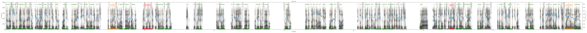

# q2_d_r4

Голос: **ron4_kejilgan** · длительность 41.4 с
Естественность (UTMOS): **2.54 из 5** (живой диктор ≈ 4–4.5)
Эталон: Когд+а с+олнце спр+яталось з+а л+есом +и в+о двор+е ст+ало совс+ем т+ихо, Б+арсик, кот+орый в+есь д+ень иск+ал золот+ой кл+юч, останов+ился +у вор+от ст+арого з+амка, присл+ушался +и ш+ёпотом спрос+ил: П+ик, т+ы сл+ышишь? — +а мыш+онок, х+оть +и дрож+ал +от стр+аха, отв+етил н+е ср+азу: Сл+ышу… Т+олько кт+о +это т+ам — Р+он +или, м+ожет б+ыть, сов+а? — +и т+ут +из темнот+ы к+ак в+ыскочит кт+о-то больш+ой д+а к+ак закрич+ит: Ур+а, +я в+ас наш+ёл! — т+ак чт+о друзь+я снач+ала испуг+ались, пот+ом рассме+ялись, +а пот+ом вс+е вм+есте — +и к+от, +и мыш+онок, +и п+ёс — побеж+али дом+ой п+ить ч+ай с мал+иновым вар+еньем!
Распознано: Когда солнце спряталось за лесом и во дворе стало совсем тихо, барсик, который весь день искал золотой ключ, остановился у ворот старого замка, прислушался и шепотом спросил. «Пик, ты слышишь? А мышонок, хоть и дрожал от страха, ответил не сразу. Слышу. Только кто это там рон или, может быть, сова? И тут и стимна ты как выскочит, кто это большой, да как закричит. Урааа! Я вас нашёл так, что друзья сначала испугались, потом рассмеялись, а потом все вместе и кот, и мышонок, и пёс побежали домой пить чай с малиновым вареньем.
Расхождения в словах: «из темноты» → «и стимна ты»; «кто-то» → «кто это»; «ура» → «урааа»

## Ударения
(где нужно: дано в тексте)

| слово | нужно | у голоса | |
|---|---|---|---|
| когда | когдА | когдА | ✓ |
| солнце | сОлнце | сОлнце | ✓ |
| спряталось | спрЯталось | спрЯталось | ✓ |
| лесом | лЕсом | лЕсом | ✓ |
| дворе | дворЕ | дворЕ | ✓ |
| стало | стАло | стАло | ✓ |
| совсем | совсЕм | совсЕм | ✓ |
| тихо | тИхо | тИхо | ✓ |
| барсик | бАрсик | бАрсик | ✓ |
| который | котОрый | котОрый | ✓ |
| искал | искАл | искАл | ✓ |
| золотой | золотОй | золотОй | ✓ |
| остановился | остановИлся | остановилсЯ | ✗? возможно — послушать |
| ворот | ворОт | ворОт | ✓ |
| старого | стАрого | стАрого | ✓ |
| замка | зАмка | зАмка | ✓ |
| прислушался | прислУшался | прислушалсЯ | ✗ ОШИБКА |
| шёпотом | шЁпотом | шЁпотом | ✓ |
| спросил | спросИл | спросИл | ✓ |
| слышишь | слЫшишь | слЫшишь | ✓ |
| мышонок | мышОнок | мышОнок | ✓ |
| дрожал | дрожАл | дрожАл | ✓ |
| страха | стрАха | стрАха | ✓ |
| ответил | отвЕтил | отвЕтил | ✓ |
| сразу | срАзу | срАзу | ✓ |
| слышу | слЫшу | слЫшу | ✓ |
| только | тОлько | тОлько | ✓ |
| это | Это | Это | ✓ |
| или | Или | Или | ✓ |
| может | мОжет | мОжет | ✓ |
| сова | совА | совА | ✓ |
| темноты | темнотЫ | темнотЫ | ✓ |
| выскочит | вЫскочит | вЫскочит | ✓ |
| кто-то | ктО-то | ктО-то | ✓ |
| большой | большОй | большОй | ✓ |
| закричит | закричИт | закрИчит | ? не разобрать |
| ура | урА | урА | ✓ |
| нашёл | нашЁл | нашЁл | ✓ |
| друзья | друзьЯ | дрУзья | ✗ ОШИБКА |
| сначала | сначАла | сначАла | ✓ |
| испугались | испугАлись | испугАлись | ✓ |
| потом | потОм | потОм | ✓ |
| рассмеялись | рассмеЯлись | — | ? |
| потом | потОм | потОм | ✓ |
| вместе | вмЕсте | вмЕсте | ✓ |
| мышонок | мышОнок | мышОнок | ✓ |
| побежали | побежАли | побЕжали | ? не разобрать |
| домой | домОй | домОй | ✓ |
| малиновым | малИновым | малинОвым | ✗? возможно — послушать |
| вареньем | варЕньем | варЕньем | ✓ |

## Интонация
- ✗ «когда солнце спряталось за лесом и во дворе стало совсем тихо барсик который весь день искал золотой ключ остановился у ворот старого замка прислушался и шёпотом спросил пик ты слышишь?—» — конец фразы не понижается — звучит незаконченно / как перечисление
- ✗ «а мышонок хоть и дрожал от страха ответил не сразу слышу…» — конец фразы не понижается — звучит незаконченно / как перечисление
- ✓ «только кто это там рон или может быть сова?—» — вопросительный подъём на слове «кто»
- ✗ «и тут из темноты как выскочит кто-то большой да как закричит ура я вас нашёл!—» — восклицание звучит ровно, без эмоции
- ✓ «так что друзья сначала испугались потом рассмеялись а потом все вместе и кот и мышонок и пёс побежали домой пить чай с малиновым вареньем!» — выделено слово «пить» (+3.0 пт)
- Диапазон голоса 7.1 полутонов (живо), средняя высота 174 Гц

## Паузы и темп
- после «нашёл!—» пауза всего 0.08 с — фразы слипаются
- Темп 5.7 слога/с (нормально)

_Синяя линия — высота голоса. Над словами заглавная буква — где ударение должно быть; красным — голос поставил не туда (уверенно), оранжевым — возможно._
