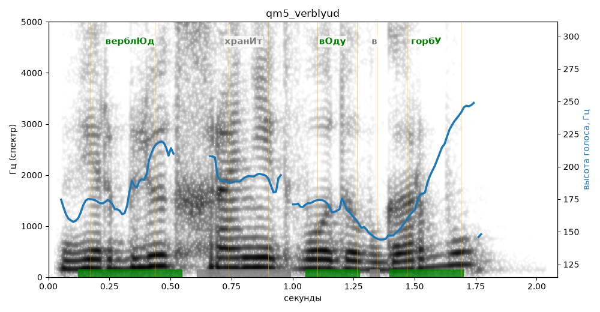

# qm5_verblyud

Голос: **silero_cis:ru_albina@ssml,soft,vrisew380** · длительность 2.1 с
Естественность (UTMOS): **2.54 из 5** (живой диктор ≈ 4–4.5)
Эталон: Верблюд хранит воду в горбу?
Распознано: Верблюд хранит воду в горбу.
Слова: все совпали

## Ударения
(где нужно: ruaccent)

| слово | нужно | у голоса | |
|---|---|---|---|
| верблюд | верблЮд | верблЮд | ✓ |
| хранит | хранИт | хрАнит | ? не разобрать |
| воду | вОду | вОду | ✓ |
| горбу | горбУ | горбУ | ✓ |

## Интонация
- ✓ «верблюд хранит воду в горбу?» — вопросительный подъём на слове «горбу»
- Диапазон голоса 8.1 полутонов (живо), средняя высота 175 Гц

## Паузы и темп
- паузы на своих местах
- Темп 5.7 слога/с (нормально)

_Синяя линия — высота голоса. Над словами заглавная буква — где ударение должно быть; красным — голос поставил не туда (уверенно), оранжевым — возможно._
