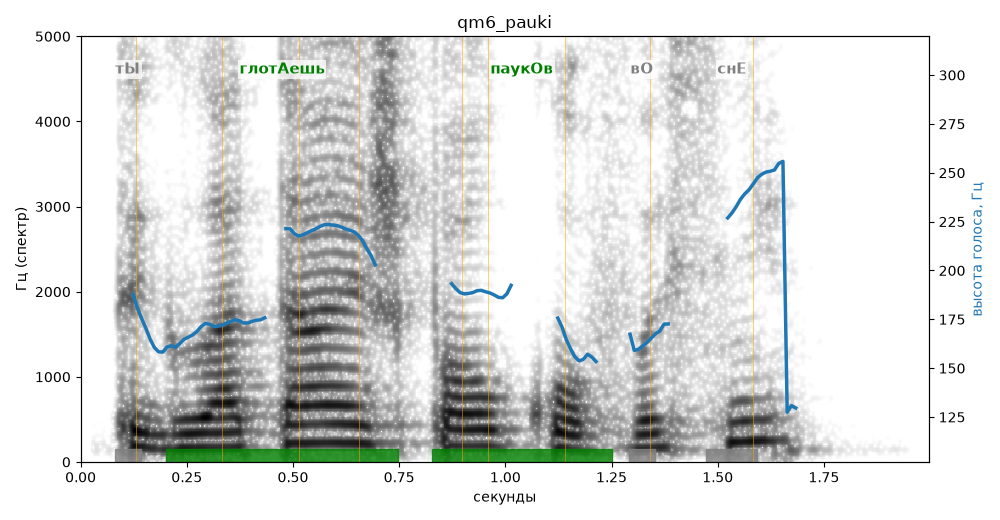

# qm6_pauki

Голос: **silero_cis:ru_albina@ssml,soft,vrisew450** · длительность 2.0 с
Естественность (UTMOS): **3.11 из 5** (живой диктор ≈ 4–4.5)
Эталон: Ты глотаешь пауков во сне?
Распознано: Ты глотаешь пауков в сне?
Расхождения в словах: «во» → «в»

## Ударения
(где нужно: ruaccent)

| слово | нужно | у голоса | |
|---|---|---|---|
| глотаешь | глотАешь | глотАешь | ✓ |
| пауков | паукОв | паукОв | ✓ |

## Интонация
- ✓ «ты глотаешь пауков во сне?» — вопросительный подъём на слове «сне»
- Диапазон голоса 8.2 полутонов (живо), средняя высота 178 Гц

## Паузы и темп
- паузы на своих местах
- Темп 5.9 слога/с (нормально)

_Синяя линия — высота голоса. Над словами заглавная буква — где ударение должно быть; красным — голос поставил не туда (уверенно), оранжевым — возможно._
