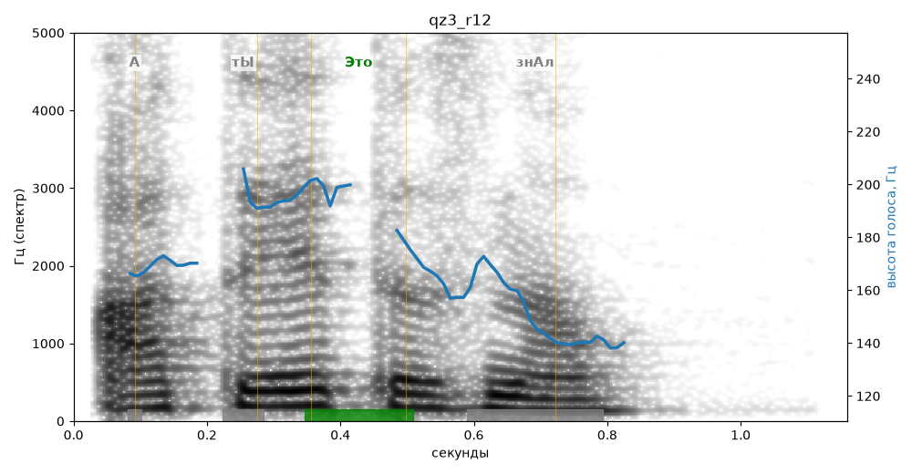

# qz3_r12

Голос: **silero_cis:ru_albina@ssml,soft,rise12w350** · длительность 1.2 с
Естественность (UTMOS): **3.27 из 5** (живой диктор ≈ 4–4.5)
Эталон: А ты это знал?
Распознано: А ты это знал?
Слова: все совпали

## Ударения
(где нужно: ruaccent)

| слово | нужно | у голоса | |
|---|---|---|---|
| это | Это | Это | ✓ |

## Интонация
- ✓ «а ты это знал?» — вопросительный подъём на слове «это»
- Диапазон голоса 6.2 полутонов (нормально), средняя высота 169 Гц

## Паузы и темп
- паузы на своих местах
- Темп 7.0 слога/с (быстро)

_Синяя линия — высота голоса. Над словами заглавная буква — где ударение должно быть; красным — голос поставил не туда (уверенно), оранжевым — возможно._
