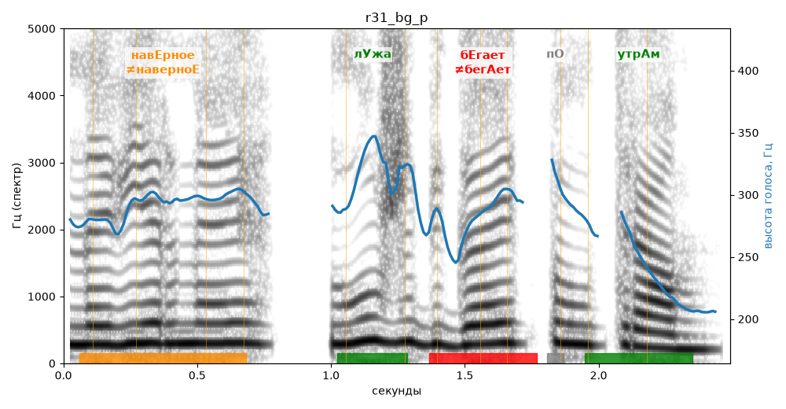

# r31_bg_p

Голос: **голос iPhone (Milena, Mac) — с «+»** · длительность 2.5 с
Естественность (UTMOS): **2.62 из 5** (живой диктор ≈ 4–4.5)
Эталон: Наверное, лужа бегает по утрам.
Распознано: Наверное, лужа бегает по утрам.
Слова: все совпали

## Ударения
(где нужно: ruaccent)

| слово | нужно | у голоса | |
|---|---|---|---|
| наверное | навЕрное | наверноЕ | ✗? возможно — послушать |
| лужа | лУжа | лУжа | ✓ |
| бегает | бЕгает | бегАет | ✗ ОШИБКА |
| утрам | утрАм | утрАм | ✓ |

## Интонация
- ✓ «наверное лужа бегает по утрам.» — конец фразы понижается — звучит законченно
- Диапазон голоса 7.8 полутонов (живо), средняя высота 289 Гц

## Паузы и темп
- паузы на своих местах
- Темп 6.2 слога/с (нормально)

_Синяя линия — высота голоса. Над словами заглавная буква — где ударение должно быть; красным — голос поставил не туда (уверенно), оранжевым — возможно._
