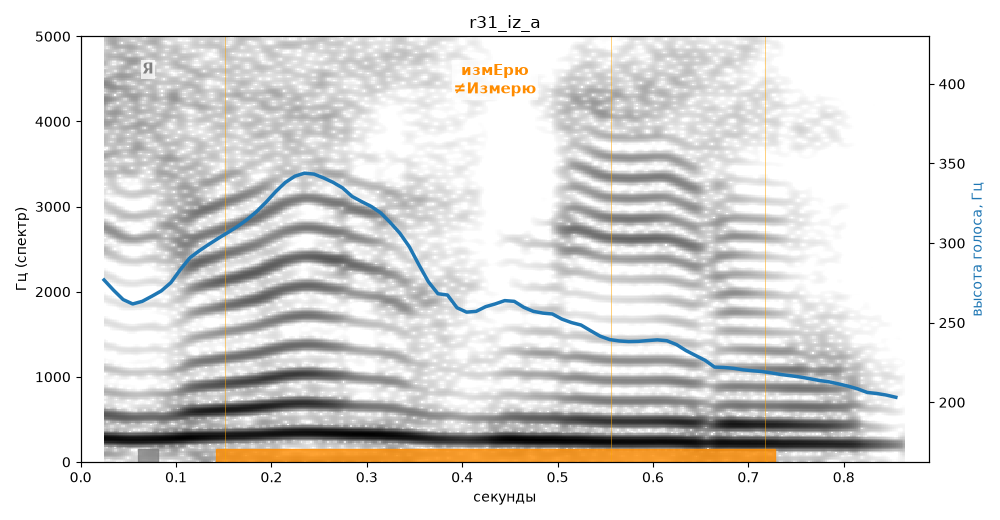

# r31_iz_a

Голос: **голос iPhone (Milena, Mac) — сам** · длительность 0.9 с
Естественность (UTMOS): **2.89 из 5** (живой диктор ≈ 4–4.5)
Эталон: Я измерю!
Распознано: Я измерю.
Слова: все совпали

## Ударения
(где нужно: ruaccent)

| слово | нужно | у голоса | |
|---|---|---|---|
| измерю | измЕрю | Измерю | ✗? возможно — послушать |

## Интонация
- ✗ «я измерю!» — восклицание звучит ровно, без эмоции
- Диапазон голоса 8.4 полутонов (живо), средняя высота 260 Гц

## Паузы и темп
- паузы на своих местах
- Темп 4.5 слога/с (нормально)

_Синяя линия — высота голоса. Над словами заглавная буква — где ударение должно быть; красным — голос поставил не туда (уверенно), оранжевым — возможно._
