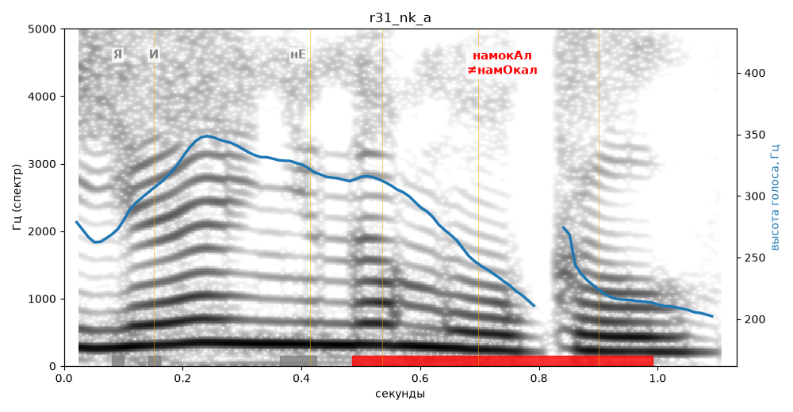

# r31_nk_a

Голос: **голос iPhone (Milena, Mac) — сам** · длительность 1.1 с
Естественность (UTMOS): **2.47 из 5** (живой диктор ≈ 4–4.5)
Эталон: Я и не намокал.
Распознано: Я и не намокал.
Слова: все совпали

## Ударения
(где нужно: ruaccent)

| слово | нужно | у голоса | |
|---|---|---|---|
| намокал | намокАл | намОкал | ✗ ОШИБКА |

## Интонация
- ✓ «я и не намокал.» — конец фразы понижается — звучит законченно
- Диапазон голоса 8.7 полутонов (живо), средняя высота 282 Гц

## Паузы и темп
- паузы на своих местах
- Темп 7.1 слога/с (быстро)

_Синяя линия — высота голоса. Над словами заглавная буква — где ударение должно быть; красным — голос поставил не туда (уверенно), оранжевым — возможно._
