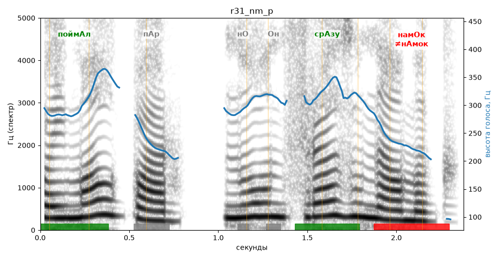

# r31_nm_p

Голос: **голос iPhone (Milena, Mac) — с «+»** · длительность 2.4 с
Естественность (UTMOS): **2.7 из 5** (живой диктор ≈ 4–4.5)
Эталон: Поймал пар. Но он сразу намок.
Распознано: Поймал пар, но он сразу намок.
Слова: все совпали

## Ударения
(где нужно: ruaccent)

| слово | нужно | у голоса | |
|---|---|---|---|
| поймал | поймАл | поймАл | ✓ |
| сразу | срАзу | срАзу | ✓ |
| намок | намОк | нАмок | ✗ ОШИБКА |

## Интонация
- ✓ «поймал пар.» — конец фразы понижается — звучит законченно
- ✓ «но он сразу намок.» — конец фразы понижается — звучит законченно
- Диапазон голоса 9.0 полутонов (живо), средняя высота 290 Гц

## Паузы и темп
- паузы на своих местах
- Темп 4.7 слога/с (нормально)

_Синяя линия — высота голоса. Над словами заглавная буква — где ударение должно быть; красным — голос поставил не туда (уверенно), оранжевым — возможно._
