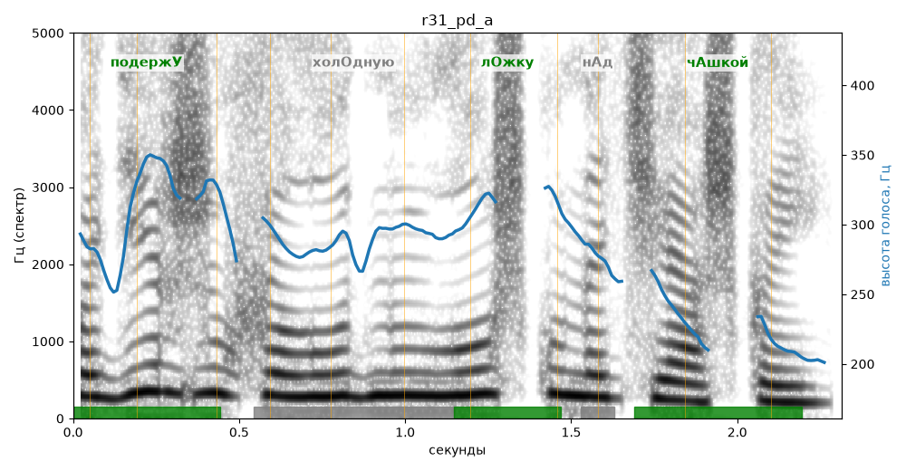

# r31_pd_a

Голос: **голос iPhone (Milena, Mac) — сам** · длительность 2.3 с
Естественность (UTMOS): **2.43 из 5** (живой диктор ≈ 4–4.5)
Эталон: Подержу холодную ложку над чашкой.
Распознано: Подержу холодную ложку начашкой.
Расхождения в словах: «над чашкой» → «начашкой»

## Ударения
(где нужно: ruaccent)

| слово | нужно | у голоса | |
|---|---|---|---|
| подержу | подержУ | подержУ | ✓ |
| холодную | холОдную | — | ? |
| ложку | лОжку | лОжку | ✓ |
| чашкой | чАшкой | чАшкой | ✓ |

## Интонация
- ✓ «подержу холодную ложку над чашкой.» — конец фразы понижается — звучит законченно
- Диапазон голоса 8.3 полутонов (живо), средняя высота 289 Гц

## Паузы и темп
- паузы на своих местах
- Темп 5.0 слога/с (нормально)

_Синяя линия — высота голоса. Над словами заглавная буква — где ударение должно быть; красным — голос поставил не туда (уверенно), оранжевым — возможно._
