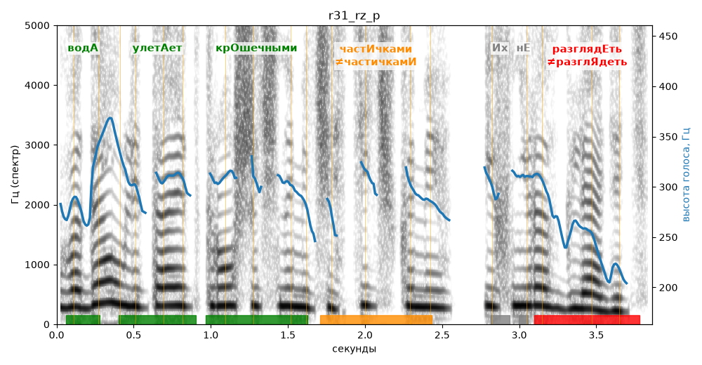

# r31_rz_p

Голос: **голос iPhone (Milena, Mac) — с «+»** · длительность 3.9 с
Естественность (UTMOS): **2.66 из 5** (живой диктор ≈ 4–4.5)
Эталон: Вода улетает крошечными частичками — их не разглядеть.
Распознано: Вода улетает крошечными частичками, их не разглядеть.
Слова: все совпали

## Ударения
(где нужно: ruaccent)

| слово | нужно | у голоса | |
|---|---|---|---|
| вода | водА | водА | ✓ |
| улетает | улетАет | улетАет | ✓ |
| крошечными | крОшечными | крОшечными | ✓ |
| частичками | частИчками | частичкамИ | ✗? возможно — послушать |
| разглядеть | разглядЕть | разглЯдеть | ✗ ОШИБКА |

## Интонация
- ✓ «вода улетает крошечными частичками их не разглядеть.» — конец фразы понижается — звучит законченно
- Диапазон голоса 7.4 полутонов (живо), средняя высота 295 Гц

## Паузы и темп
- паузы на своих местах
- Темп 5.7 слога/с (нормально)

_Синяя линия — высота голоса. Над словами заглавная буква — где ударение должно быть; красным — голос поставил не туда (уверенно), оранжевым — возможно._
