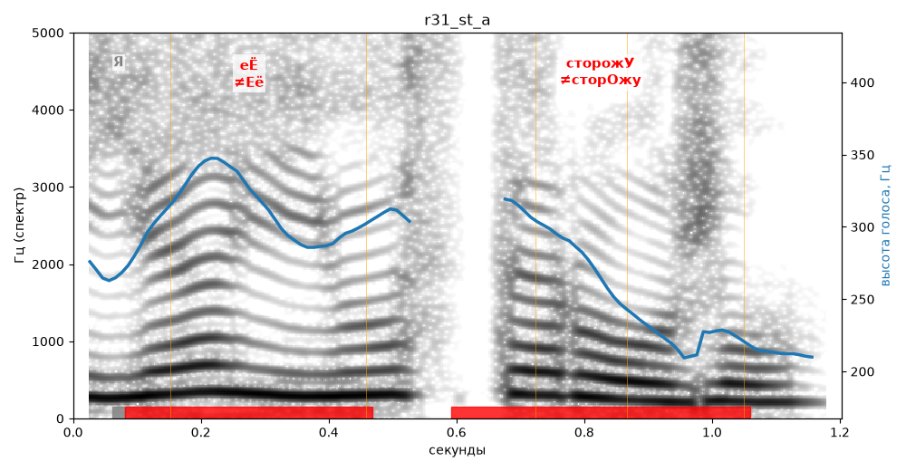

# r31_st_a

Голос: **голос iPhone (Milena, Mac) — сам** · длительность 1.2 с
Естественность (UTMOS): **2.33 из 5** (живой диктор ≈ 4–4.5)
Эталон: Я её сторожу.
Распознано: Я ее осторожу.
Расхождения в словах: «сторожу» → «осторожу»

## Ударения
(где нужно: ruaccent)

| слово | нужно | у голоса | |
|---|---|---|---|
| её | еЁ | Её | ✗ ОШИБКА |
| сторожу | сторожУ | сторОжу | ✗ ОШИБКА |

## Интонация
- ✓ «я её сторожу.» — конец фразы понижается — звучит законченно
- Диапазон голоса 8.3 полутонов (живо), средняя высота 287 Гц

## Паузы и темп
- паузы на своих местах
- Темп 5.0 слога/с (нормально)

_Синяя линия — высота голоса. Над словами заглавная буква — где ударение должно быть; красным — голос поставил не туда (уверенно), оранжевым — возможно._
