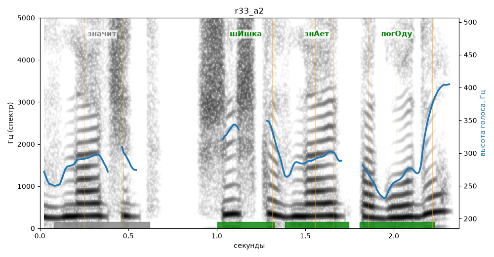

# r33_a2

Голос: **Mac Milena (Рон), мягкий перенос** · длительность 2.4 с
Естественность (UTMOS): **2.7 из 5** (живой диктор ≈ 4–4.5)
Эталон: Значит, шишка знает погоду?
Распознано: Значит, шишка знает погоду?
Слова: все совпали

## Ударения
(где нужно: ruaccent)

| слово | нужно | у голоса | |
|---|---|---|---|
| значит | значит | знАчит | нет эталона |
| шишка | шИшка | шИшка | ✓ |
| знает | знАет | знАет | ✓ |
| погоду | погОду | погОду | ✓ |

## Интонация
- ✗ «значит шишка знает погоду?» — нет вопросительного подъёма (самое высокое место — «шишка», в начале) — звучит как утверждение
- Диапазон голоса 7.9 полутонов (живо), средняя высота 287 Гц

## Паузы и темп
- паузы на своих местах
- Темп 5.1 слога/с (нормально)

_Синяя линия — высота голоса. Над словами заглавная буква — где ударение должно быть; красным — голос поставил не туда (уверенно), оранжевым — возможно._
