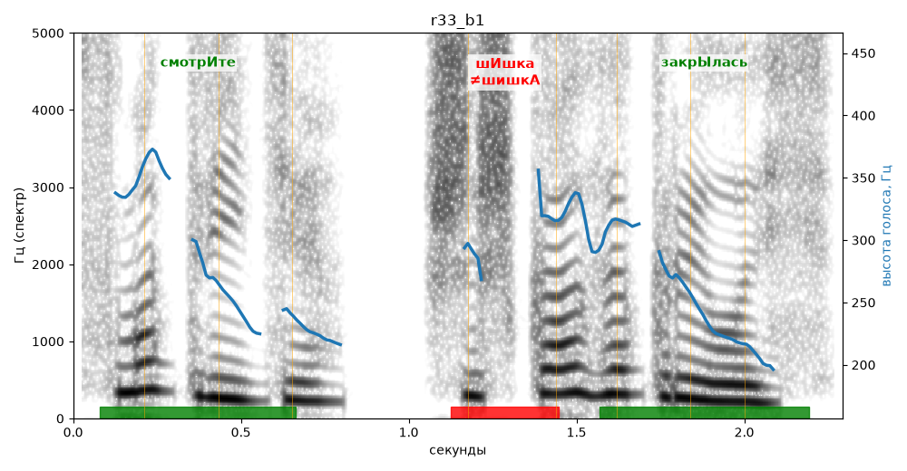

# r33_b1

Голос: **Mac Milena (Рон), сам** · длительность 2.3 с
Естественность (UTMOS): **3.21 из 5** (живой диктор ≈ 4–4.5)
Эталон: Смотрите! Шишка закрылась!
Распознано: Смотрите, шишка закрылась.
Слова: все совпали

## Ударения
(где нужно: ruaccent)

| слово | нужно | у голоса | |
|---|---|---|---|
| смотрите | смотрИте | смотрИте | ✓ |
| шишка | шИшка | шишкА | ✗ ОШИБКА |
| закрылась | закрЫлась | закрЫлась | ✓ |

## Интонация
- ✗ «смотрите!» — восклицание звучит ровно, без эмоции
- ✗ «шишка закрылась!» — восклицание звучит ровно, без эмоции
- Диапазон голоса 9.0 полутонов (живо), средняя высота 270 Гц

## Паузы и темп
- паузы на своих местах
- Темп 4.9 слога/с (нормально)

_Синяя линия — высота голоса. Над словами заглавная буква — где ударение должно быть; красным — голос поставил не туда (уверенно), оранжевым — возможно._
