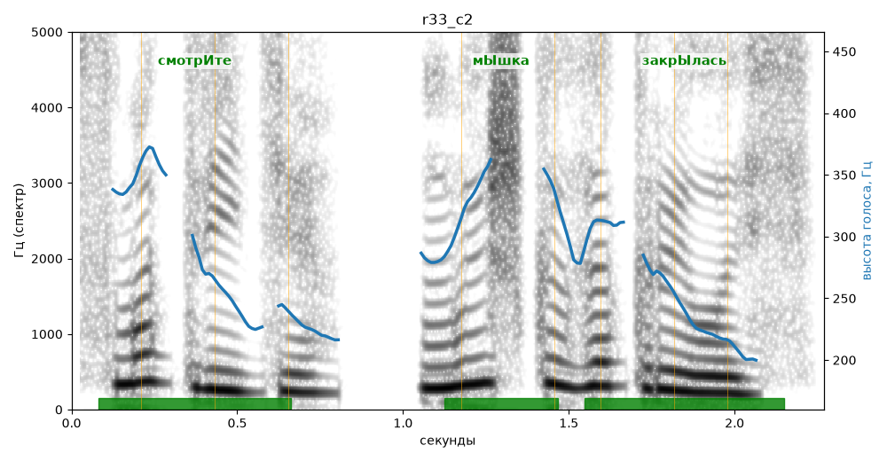

# r33_c2

Голос: **Mac Milena (Рон), сам** · длительность 2.3 с
Естественность (UTMOS): **3.22 из 5** (живой диктор ≈ 4–4.5)
Эталон: Смотрите! Мышка закрылась!
Распознано: Смотрите, мышка закрылась.
Слова: все совпали

## Ударения
(где нужно: ruaccent)

| слово | нужно | у голоса | |
|---|---|---|---|
| смотрите | смотрИте | смотрИте | ✓ |
| мышка | мЫшка | мЫшка | ✓ |
| закрылась | закрЫлась | закрЫлась | ✓ |

## Интонация
- ✗ «смотрите!» — восклицание звучит ровно, без эмоции
- ✗ «мышка закрылась!» — восклицание звучит ровно, без эмоции
- Диапазон голоса 9.0 полутонов (живо), средняя высота 273 Гц

## Паузы и темп
- паузы на своих местах
- Темп 5.0 слога/с (нормально)

_Синяя линия — высота голоса. Над словами заглавная буква — где ударение должно быть; красным — голос поставил не туда (уверенно), оранжевым — возможно._
