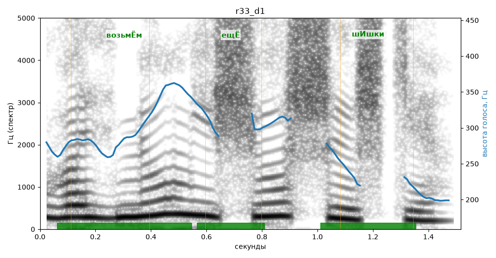

# r33_d1

Голос: **Mac Milena (Рон), сам** · длительность 1.5 с
Естественность (UTMOS): **2.63 из 5** (живой диктор ≈ 4–4.5)
Эталон: Возьмём ещё шишки.
Распознано: Возьмём ещё шишки.
Слова: все совпали

## Ударения
(где нужно: ruaccent)

| слово | нужно | у голоса | |
|---|---|---|---|
| возьмём | возьмЁм | возьмЁм | ✓ |
| ещё | ещЁ | ещЁ | ✓ |
| шишки | шИшки | шИшки | ✓ |

## Интонация
- ✓ «возьмём ещё шишки.» — конец фразы понижается — звучит законченно
- Диапазон голоса 10.1 полутонов (живо), средняя высота 283 Гц

## Паузы и темп
- паузы на своих местах
- Темп 5.5 слога/с (нормально)

_Синяя линия — высота голоса. Над словами заглавная буква — где ударение должно быть; красным — голос поставил не туда (уверенно), оранжевым — возможно._
