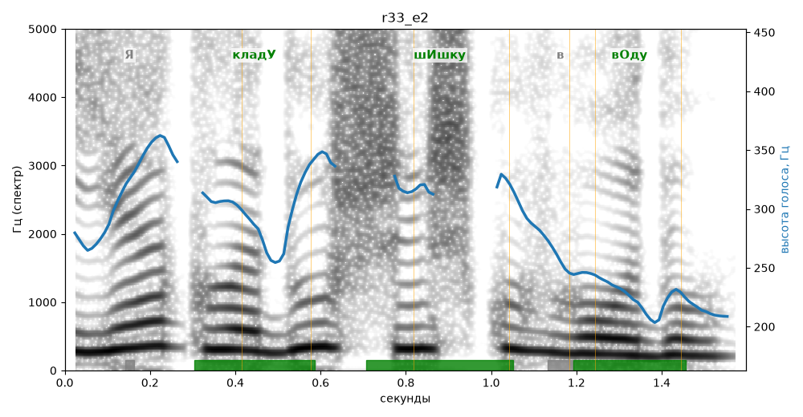

# r33_e2

Голос: **Mac Milena (Рон), мягкий перенос** · длительность 1.6 с
Естественность (UTMOS): **2.62 из 5** (живой диктор ≈ 4–4.5)
Эталон: Я кладу шишку в воду.
Распознано: Я кладу шишку в воду.
Слова: все совпали

## Ударения
(где нужно: ruaccent)

| слово | нужно | у голоса | |
|---|---|---|---|
| кладу | кладУ | кладУ | ✓ |
| шишку | шИшку | шИшку | ✓ |
| воду | вОду | вОду | ✓ |

## Интонация
- ✓ «я кладу шишку в воду.» — конец фразы понижается — звучит законченно
- Диапазон голоса 8.8 полутонов (живо), средняя высота 285 Гц

## Паузы и темп
- паузы на своих местах
- Темп 5.3 слога/с (нормально)

_Синяя линия — высота голоса. Над словами заглавная буква — где ударение должно быть; красным — голос поставил не туда (уверенно), оранжевым — возможно._
