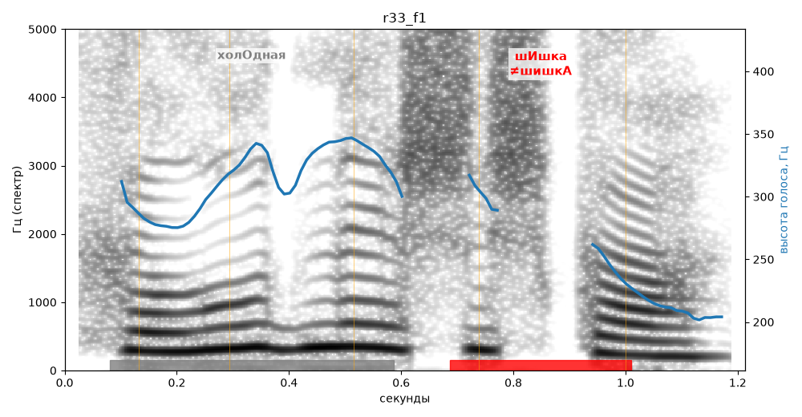

# r33_f1

Голос: **Mac Milena, сам** · длительность 1.2 с
Естественность (UTMOS): **2.84 из 5** (живой диктор ≈ 4–4.5)
Эталон: Холодная шишка!
Распознано: Холодная шишка.
Слова: все совпали

## Ударения
(где нужно: ruaccent)

| слово | нужно | у голоса | |
|---|---|---|---|
| холодная | холОдная | — | ? |
| шишка | шИшка | шишкА | ✗ ОШИБКА |

## Интонация
- ✗ «холодная шишка!» — восклицание звучит ровно, без эмоции
- Диапазон голоса 9.0 полутонов (живо), средняя высота 298 Гц

## Паузы и темп
- паузы на своих местах
- Темп 5.4 слога/с (нормально)

_Синяя линия — высота голоса. Над словами заглавная буква — где ударение должно быть; красным — голос поставил не туда (уверенно), оранжевым — возможно._
