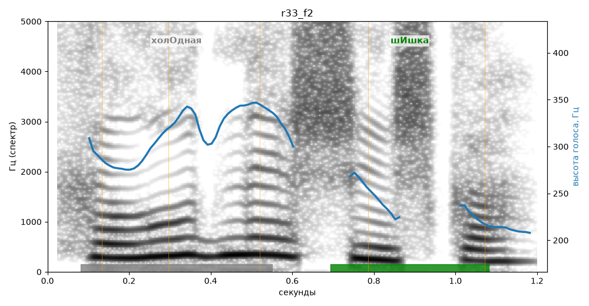

# r33_f2

Голос: **Mac Milena, перенос** · длительность 1.2 с
Естественность (UTMOS): **2.6 из 5** (живой диктор ≈ 4–4.5)
Эталон: Холодная шишка!
Распознано: Холодная шишка.
Слова: все совпали

## Ударения
(где нужно: ruaccent)

| слово | нужно | у голоса | |
|---|---|---|---|
| холодная | холОдная | — | ? |
| шишка | шИшка | шИшка | ✓ |

## Интонация
- ✓ «холодная шишка!» — выделено слово «холодная» (+2.1 пт)
- Диапазон голоса 8.5 полутонов (живо), средняя высота 286 Гц

## Паузы и темп
- паузы на своих местах
- Темп 5.0 слога/с (нормально)

_Синяя линия — высота голоса. Над словами заглавная буква — где ударение должно быть; красным — голос поставил не туда (уверенно), оранжевым — возможно._
