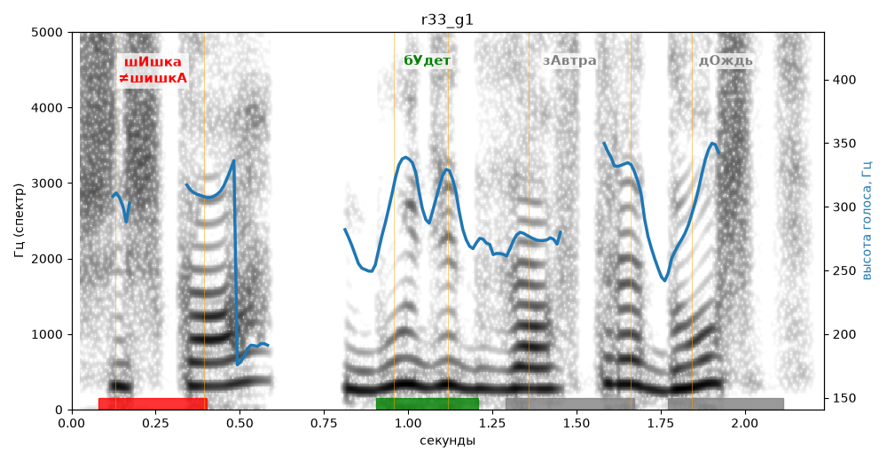

# r33_g1

Голос: **Mac Milena, сам** · длительность 2.2 с
Естественность (UTMOS): **2.89 из 5** (живой диктор ≈ 4–4.5)
Эталон: Шишка, будет завтра дождь?
Распознано: Шишка будет завтра дождь.
Слова: все совпали

## Ударения
(где нужно: ruaccent)

| слово | нужно | у голоса | |
|---|---|---|---|
| шишка | шИшка | шишкА | ✗ ОШИБКА |
| будет | бУдет | бУдет | ✓ |
| завтра | зАвтра | завтрА | ? не разобрать |

## Интонация
- ✗ «шишка будет завтра дождь?» — нет вопросительного подъёма (самое высокое место — «шишка», в начале) — звучит как утверждение
- Диапазон голоса 9.9 полутонов (живо), средняя высота 287 Гц

## Паузы и темп
- паузы на своих местах
- Темп 4.6 слога/с (нормально)

_Синяя линия — высота голоса. Над словами заглавная буква — где ударение должно быть; красным — голос поставил не туда (уверенно), оранжевым — возможно._
