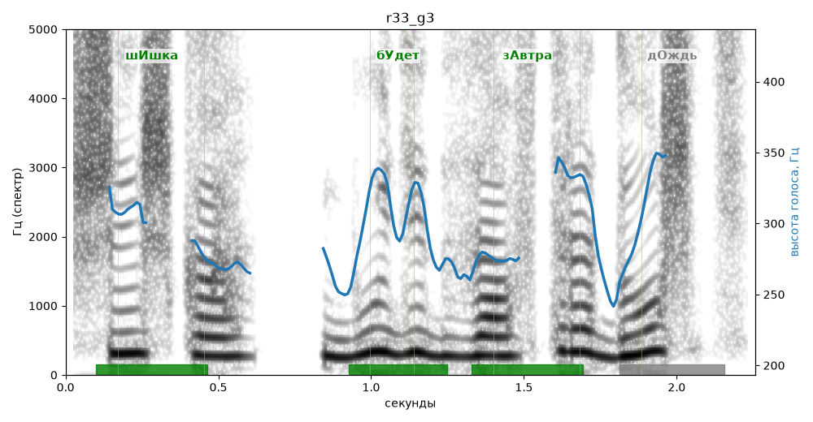

# r33_g3

Голос: **Mac Milena, перенос** · длительность 2.3 с
Естественность (UTMOS): **2.75 из 5** (живой диктор ≈ 4–4.5)
Эталон: Шишка, будет завтра дождь?
Распознано: Шишка, будет завтра дождь?
Слова: все совпали

## Ударения
(где нужно: ruaccent)

| слово | нужно | у голоса | |
|---|---|---|---|
| шишка | шИшка | шИшка | ✓ |
| будет | бУдет | бУдет | ✓ |
| завтра | зАвтра | зАвтра | ✓ |

## Интонация
- ✗ «шишка будет завтра дождь?» — нет вопросительного подъёма (самое высокое место — «шишка», в начале) — звучит как утверждение
- Диапазон голоса 5.2 полутонов (нормально), средняя высота 280 Гц

## Паузы и темп
- паузы на своих местах
- Темп 4.4 слога/с (нормально)

_Синяя линия — высота голоса. Над словами заглавная буква — где ударение должно быть; красным — голос поставил не туда (уверенно), оранжевым — возможно._
