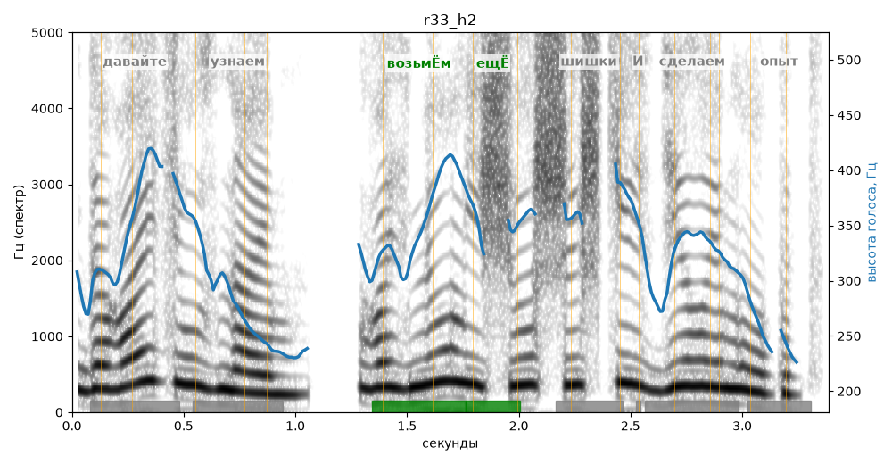

# r33_h2

Голос: **Mac Milena (Пик)** · длительность 3.4 с
Естественность (UTMOS): **2.49 из 5** (живой диктор ≈ 4–4.5)
Эталон: Давайте узнаем. Возьмём ещё шишки и сделаем опыт.
Распознано: Давайте узнаем. Возьмём ещё шишки и сделаем опыт.
Слова: все совпали

## Ударения
(где нужно: нет)

| слово | нужно | у голоса | |
|---|---|---|---|
| давайте | давайте | давАйте | нет эталона |
| узнаем | узнаем | узнАем | нет эталона |
| возьмём | возьмЁм | возьмЁм | ✓ |
| ещё | ещЁ | ещЁ | ✓ |
| шишки | шишки | шишкИ | нет эталона |
| сделаем | сделаем | сдЕлаем | нет эталона |
| опыт | опыт | Опыт | нет эталона |

## Интонация
- ✓ «давайте узнаем.» — конец фразы понижается — звучит законченно
- ✓ «возьмём ещё шишки и сделаем опыт.» — конец фразы понижается — звучит законченно
- Диапазон голоса 9.4 полутонов (живо), средняя высота 325 Гц

## Паузы и темп
- паузы на своих местах
- Темп 6.8 слога/с (быстро)

_Синяя линия — высота голоса. Над словами заглавная буква — где ударение должно быть; красным — голос поставил не туда (уверенно), оранжевым — возможно._
