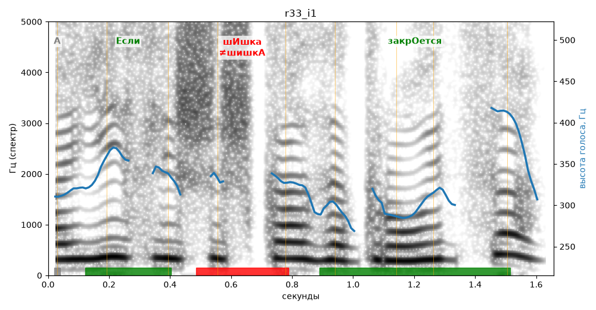

# r33_i1

Голос: **Mac Milena (Пик)** · длительность 1.7 с
Естественность (UTMOS): **2.67 из 5** (живой диктор ≈ 4–4.5)
Эталон: А если шишка закроется?
Распознано: А если шишка закроется?
Слова: все совпали

## Ударения
(где нужно: ruaccent)

| слово | нужно | у голоса | |
|---|---|---|---|
| если | Если | Если | ✓ |
| шишка | шИшка | шишкА | ✗ ОШИБКА |
| закроется | закрОется | закрОется | ✓ |

## Интонация
- ✗ «а если шишка закроется?» — нет вопросительного подъёма (самое высокое место — «если», в начале) — звучит как утверждение
- Диапазон голоса 6.3 полутонов (нормально), средняя высота 321 Гц

## Паузы и темп
- паузы на своих местах
- Темп 6.0 слога/с (нормально)

_Синяя линия — высота голоса. Над словами заглавная буква — где ударение должно быть; красным — голос поставил не туда (уверенно), оранжевым — возможно._
