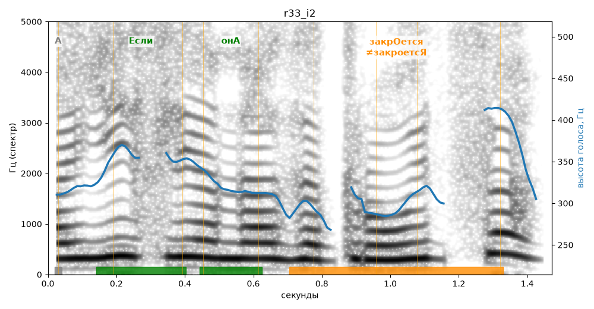

# r33_i2

Голос: **Mac Milena (Пик)** · длительность 1.5 с
Естественность (UTMOS): **2.73 из 5** (живой диктор ≈ 4–4.5)
Эталон: А если она закроется?
Распознано: А если она закроется?
Слова: все совпали

## Ударения
(где нужно: ruaccent)

| слово | нужно | у голоса | |
|---|---|---|---|
| если | Если | Если | ✓ |
| она | онА | онА | ✓ |
| закроется | закрОется | закроетсЯ | ✗? возможно — послушать |

## Интонация
- ✗ «а если она закроется?» — нет вопросительного подъёма (самое высокое место — «если», в начале) — звучит как утверждение
- Диапазон голоса 6.3 полутонов (нормально), средняя высота 316 Гц

## Паузы и темп
- паузы на своих местах
- Темп 6.9 слога/с (быстро)

_Синяя линия — высота голоса. Над словами заглавная буква — где ударение должно быть; красным — голос поставил не туда (уверенно), оранжевым — возможно._
