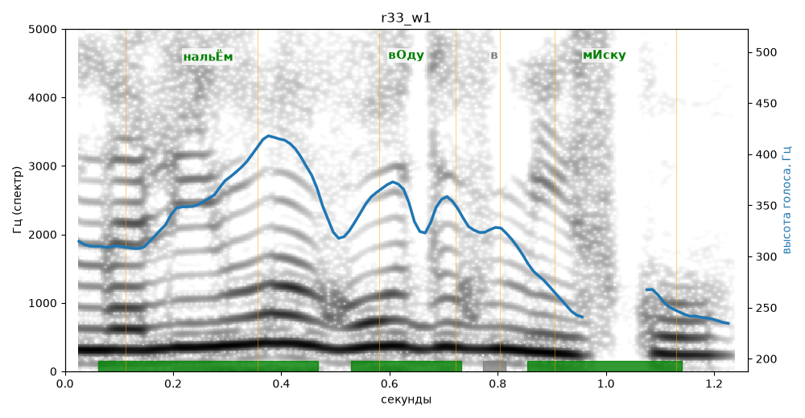

# r33_w1

Голос: **Mac Milena (Пик)** · длительность 1.3 с
Естественность (UTMOS): **2.59 из 5** (живой диктор ≈ 4–4.5)
Эталон: Нальём воду в миску.
Распознано: Наливом воду в миску.
Расхождения в словах: «нальем» → «наливом»

## Ударения
(где нужно: ruaccent)

| слово | нужно | у голоса | |
|---|---|---|---|
| нальём | нальЁм | нальЁм | ✓ |
| воду | вОду | вОду | ✓ |
| миску | мИску | мИску | ✓ |

## Интонация
- ✓ «нальём воду в миску.» — конец фразы понижается — звучит законченно
- Диапазон голоса 9.2 полутонов (живо), средняя высота 326 Гц

## Паузы и темп
- паузы на своих местах
- Темп 6.5 слога/с (нормально)

_Синяя линия — высота голоса. Над словами заглавная буква — где ударение должно быть; красным — голос поставил не туда (уверенно), оранжевым — возможно._
