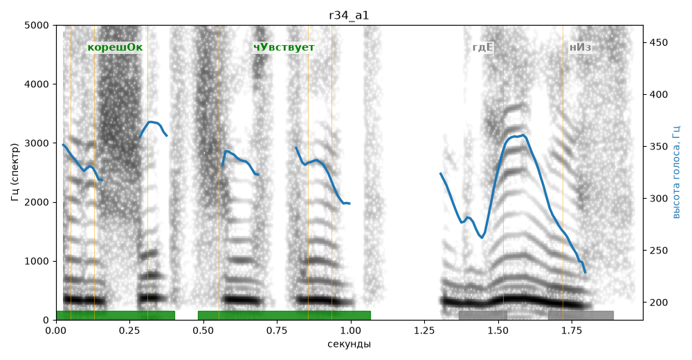

# r34_a1

Голос: **Mac Milena** · длительность 2.0 с
Естественность (UTMOS): **2.15 из 5** (живой диктор ≈ 4–4.5)
Эталон: Корешок чувствует, где низ.
Распознано: корешок чувствует, где низ.
Слова: все совпали

## Ударения
(где нужно: ruaccent)

| слово | нужно | у голоса | |
|---|---|---|---|
| корешок | корешОк | корешОк | ✓ |
| чувствует | чУвствует | чУвствует | ✓ |

## Интонация
- ✓ «корешок чувствует где низ.» — конец фразы понижается — звучит законченно
- Диапазон голоса 6.2 полутонов (нормально), средняя высота 329 Гц

## Паузы и темп
- паузы на своих местах
- Темп 5.0 слога/с (нормально)

_Синяя линия — высота голоса. Над словами заглавная буква — где ударение должно быть; красным — голос поставил не туда (уверенно), оранжевым — возможно._
